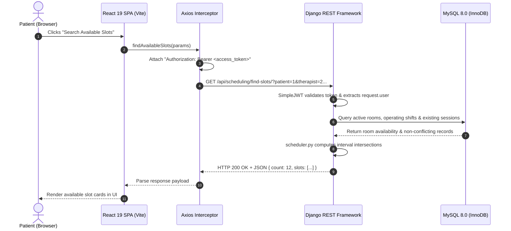

# AYURSUTRA: COMPLETE TECHNICAL INTERVIEW QUESTIONS & ANSWERS HANDBOOK
### *Comprehensive B.Tech CSE Fresher & Junior Developer Guide to Architecture, Code, Database, Scheduling, Concurrency, and System Design*

---

## 📑 Table of Contents

- [About This Handbook & Repository Audit Baseline](#about-this-handbook--repository-audit-baseline)
- [Section 1: Project Introduction and Resume Questions](#section-1-project-introduction-and-resume-questions)
- [Section 2: AyurSutra Architecture and End-to-End Request Flow](#section-2-ayursutra-architecture-and-end-to-end-request-flow)
- [Section 3: AyurSutra Database Models and Relationships](#section-3-ayursutra-database-models-and-relationships)
- [Section 4: User Authentication, Roles, and Permissions](#section-4-user-authentication-roles-and-permissions)
- [Section 5: Patient Management and Clinical Assessments](#section-5-patient-management-and-clinical-assessments)
- [Section 6: Therapy Management and Treatment Workflows](#section-6-therapy-management-and-treatment-workflows)
- [Section 7: Appointment Scheduling and Conflict Prevention](#section-7-appointment-scheduling-and-conflict-prevention)
- [Section 8: Django and Django REST Framework](#section-8-django-and-django-rest-framework)
- [Section 9: MySQL and Database Concepts Relevant to AyurSutra](#section-9-mysql-and-database-concepts-relevant-to-ayursutra)
- [Section 10: React, JavaScript, and Frontend Architecture](#section-10-react-javascript-and-frontend-architecture)
- [Section 11: Frontend-Backend Integration and API Debugging](#section-11-frontend-backend-integration-and-api-debugging)
- [Section 12: Clinical Workflow and Patient-Facing Features](#section-12-clinical-workflow-and-patient-facing-features)
- [Section 13: Transactions, Concurrency, and Data Integrity](#section-13-transactions-concurrency-and-data-integrity)
- [Section 14: Testing and Debugging](#section-14-testing-and-debugging)
- [Section 15: Security, Privacy, and Clinical Data Protection](#section-15-security-privacy-and-clinical-data-protection)
- [Section 16: Scenario-Based AyurSutra Interview Questions (25 High-Yield Scenarios)](#section-16-scenario-based-ayursutra-interview-questions-25-high-yield-scenarios)
- [Section 17: In-Depth Code Walkthroughs (5 Core Repository Excerpts)](#section-17-in-depth-code-walkthroughs-5-core-repository-excerpts)
- [Section 18: Genuine Limitations, Challenges, and Future Improvements](#section-18-genuine-limitations-challenges-and-future-improvements)
- [Section 19: Project-Specific Rapid-Fire Revision (60+ High-Frequency Q&As)](#section-19-project-specific-rapid-fire-revision-60-high-frequency-qas)
- [Section 20: Project-Related Behavioral and HR Questions](#section-20-project-related-behavioral-and-hr-questions)

---

## About This Handbook & Repository Audit Baseline

This handbook is prepared for a B.Tech Computer Science & Engineering graduate or junior software developer facing technical interviews, project viva-voce, or technical assessments for **AyurSutra**.

Every technical detail in this document has been **verified directly against the source code** of the repository:
- **Backend:** Python 3.12, Django 6.1, Django REST Framework 3.16, `djangorestframework-simplejwt`, MySQL 8.0 (InnoDB engine).
- **Frontend:** React 19, Vite 8.3, React Router DOM v7, Axios, Lucide React, Tailwind CSS / custom modern CSS.
- **Database:** 12 relational models across 4 apps (`accounts`, `patients`, `therapies`, `scheduling`).
- **Verified Test Suite:** Exactly 12 automated tests (6 in `backend/accounts/tests.py`, 6 in `backend/scheduling/tests.py`; `patients` and `therapies` test files are currently unpopulated placeholders).
- **Clinical Governance Disclaimer:** AyurSutra is a healthcare management and scheduling software platform designed to manage logistical constraints. It does not provide automated diagnostic algorithms, does not replace licensed medical practitioners, and should not be presented as a clinically validated diagnostic tool.

---

# Section 1: Project Introduction and Resume Questions

### Q1.1: What is AyurSutra?
**Short answer:** AyurSutra is a full-stack Panchakarma clinical management and multi-resource appointment scheduling web platform.

**Detailed answer:** It connects four key hospital roles—Patients, Ayurvedic Doctors (Vaidyas), Therapists, and Facility Administrators—into a unified system. Unlike generic clinic management tools that schedule a single doctor for a brief consultation, AyurSutra coordinates multi-day Panchakarma therapy regimens by validating the simultaneous availability of rooms, therapists, and patients for the exact duration of each procedure.

**Possible follow-up:** Which technologies power AyurSutra?  
**Follow-up answer:** The backend is built with Django 6.1 and Django REST Framework using MySQL 8.0, authenticated via JWT. The frontend is a Single Page Application (SPA) built with React 19 and Vite.

---

### Q1.2: How would you explain AyurSutra in 30 seconds?
**Short answer:** In an interview, deliver this concise pitch:
> *"AyurSutra is a web-based clinical management system designed for Ayurvedic Panchakarma centers. Standard hospital software assumes one doctor meets one patient in one room for 10 minutes. Panchakarma therapies require 45 to 90 minutes and depend on three scarce resources simultaneously: a specialized treatment room, a qualified therapist, and the patient. AyurSutra solves this logistical bottleneck with a conflict-free multi-resource scheduling engine, role-based workflows for four clinical personas, and progress tracking built on React, Django REST Framework, and MySQL."*

---

### Q1.3: How would you explain AyurSutra in 60 seconds?
**Short answer:** In an interview, deliver this complete summary:
> *"AyurSutra addresses a unique healthcare informatics problem: the logistical complexity of classical Panchakarma therapy. In traditional Ayurvedic medicine, detox treatments like Abhyanga and Shirodhara are administered across 7 to 21 consecutive days and require specialized wooden tables (Dronis), steam chambers, and trained therapists.*
>
> *Most clinics manage this using manual registers, resulting in room double-bookings, idle facilities, and fragmented treatment records. AyurSutra replaces this with a decoupled three-tier architecture: a React 19 frontend communicating via REST APIs with a Django backend backed by MySQL.*
>
> *The system features three core engineering highlights: first, an algorithmic multi-resource scheduling service that calculates the intersection of room, therapist, and patient availability; second, write-time conflict detection preventing concurrent double-bookings; and third, role-segregated portals allowing Vaidyas to prescribe treatments, patients to book within prescribed session quotas, and therapists to log session observations using an in-suite touch interface."*

---

### Q1.4: What specific problem does AyurSutra solve?
**Short answer:** It solves the multi-dimensional scheduling bottleneck and lack of role coordination in Panchakarma therapy centers.

**How it applies to AyurSutra:** Standard clinic software assumes a **1:1:1** mapping (1 Patient $\leftrightarrow$ 1 Doctor $\leftrightarrow$ 1 Consultation Room for 10 minutes). Panchakarma is a **many-to-three** mapping:
1. **Room Contention:** Treatment rooms are specialized (e.g., equipped with oil drainage tables or steam boxes) and limited in number.
2. **Staff Shift Constraints:** Therapists work specific shifts and often need to match patient gender preferences or procedural qualifications.
3. **Multi-Session Continuity:** A doctor prescribes 5 to 14 sessions that must be scheduled progressively without exceeding prescribed session counts.
AyurSutra prevents room and therapist collisions, enforces session quotas, and maintains digital continuity from prescription to execution.

---

### Q1.5: Why did you choose this problem?
**Short answer:** Because scheduling Panchakarma treatments is a constrained resource-allocation problem that standard booking applications fail to handle properly.

**How it applies to AyurSutra:** While exploring software project ideas, I realized that regular hospital outpatient department (OPD) software works well for general medicine, but traditional Indian medicine (AYUSH) centers are underserved by existing digital tools. Panchakarma provided an authentic, non-trivial engineering challenge involving multi-resource synchronization, interval overlap detection, and role-based permissions across multiple distinct users.

---

### Q1.6: Who are the intended users of AyurSutra?
**Short answer:** The system is built for four distinct roles defined in `accounts.models.User.Role`:
1. **PATIENT:** Can register, maintain medical profiles, search available therapy slots, book sessions within prescribed treatment limits, view therapy history, and inspect care summaries.
2. **VAIDYA (Ayurvedic Physician):** Can conduct consultations, record diagnostic assessments (Prakriti, Vikriti, vital signs, clinical observations), and prescribe structured multi-session therapy plans with phase classifications.
3. **THERAPIST:** Can view assigned daily procedures, launch an in-suite touch console during treatment, monitor countdown timers, record patient discomfort levels (0–10), and log completion notes.
4. **ADMIN:** Can manage facility infrastructure, including therapy room inventories, therapist shift schedules, clinic operating hours, and system-wide appointments.

---

### Q1.7: What are the main features of the system?
**Short answer:** The primary implemented features in the codebase are:
- **JWT-Based Authentication:** Stateless login with automatic token refresh via Axios interceptors.
- **Clinical Intake & Assessment:** Digital records for Prakriti, Vikriti, vitals, and consultation diagnoses.
- **Therapy Catalog & Prescriptions:** Master therapy catalogue with session quota limits and classical phase tagging (*Purvakarma*, *Pradhanakarma*, *Paschatkarma*).
- **Multi-Resource Scheduling Engine:** Deterministic slot discovery across rooms, therapists, and patients over configurable date ranges.
- **Write-Time Conflict Prevention:** Serializer-level interval collision checks preventing duplicate or overlapping bookings.
- **Therapist In-Suite Console:** A dedicated dark-mode touch interface with procedure timer, discomfort dial, and 1-tap progress logging.
- **Patient Dashboard & Itinerary:** Session timelines, Marma point educational map, and printable Ayurvedic EHR care summary.

---

### Q1.8: What was your individual contribution to the project?
*(Honest customizable answer template for an interview)*
**Spoken response:**
> *"In AyurSutra, I contributed across the full stack with a strong focus on backend business logic and database architecture. Specifically:
> - I designed and implemented the relational schema in Django ORM across the four core modules: `accounts`, `patients`, `therapies`, and `scheduling`.
> - I wrote the slot discovery algorithm in `backend/scheduling/services/scheduler.py` that calculates valid intervals across room operating windows, therapist shifts, and patient availability.
> - I implemented the validation logic in `TherapySessionSerializer` to enforce non-overlapping time constraints and prevent session quota overruns.
> - On the frontend, I developed the API integration layer using Axios, built the client-side role guards, and connected the React scheduling and in-suite console views to backend endpoints.
> - I wrote the automated backend API test suite verifying role-based queryset scoping and authentication."*

---

### Q1.9: What was the most challenging technical problem you encountered?
**Short answer:** Handling write-time race conditions and multi-resource interval overlap checks without corrupting booking states.

**Detailed answer:**
> *"The hardest challenge was ensuring that checking slot availability and actually booking a slot remained consistent. A slot could appear free when a patient viewed the calendar, but by the time they submitted the booking form, another user could have reserved that room or therapist.
> 
> To solve this, I decoupled the read-time slot discovery from write-time validation. Even if the frontend shows a slot as open, `TherapySessionSerializer.validate()` independently queries the database at the exact moment of booking to verify that neither the room, therapist, nor patient has an overlapping session, using the interval collision condition `(start_A < end_B AND end_A > start_B)`. If any conflict exists, the transaction fails with an HTTP 400 Bad Request."*

---

### Q1.10: What did you learn while developing AyurSutra?
**Short answer:** Key lessons learned include:
1. **Database Design:** How to use relational foreign keys with `on_delete=models.PROTECT` to protect historical healthcare data from accidental deletion.
2. **Defensive API Engineering:** Why frontend validation alone is never sufficient; security, role boundaries, and business rules must always be enforced in backend serializers and querysets.
3. **Decoupled Architecture:** How to build resilient Single Page Applications using Axios interceptors to silently refresh expired JWT tokens without interrupting active clinical sessions.
4. **Algorithmic Trade-offs:** The performance implications of looping over calendar days and time intervals, and how database query volume grows if queries are executed inside nested loops.

---

### Q1.11: Why did you choose Django and React over an all-in-one framework like Django Templates or Next.js?
**Short answer:**
- **Django + DRF:** Django provides built-in ORM security, password hashing, and migration tooling out of the box, while DRF offers clean serialization and ViewSets.
- **React 19 + Vite:** AyurSutra is an authenticated, interactive clinical portal rather than a public content site requiring search engine optimization (SEO). A client-side Single Page Application provides fluid UI transitions, dynamic timers, and interactive diagrams without full-page reloads, while Vite provides rapid development and sub-second builds.

---

### Q1.12: Why did you choose MySQL instead of MongoDB?
**Short answer:**
1. **Relational Data Model:** AyurSutra’s domain is inherently relational: Users link to Profiles, which link to Prescriptions, which link to Sessions, which link to Rooms and Therapists.
2. **ACID Transactions:** Booking a medical procedure requires transactional atomicity. Storing bookings in an eventually consistent document store risks orphaned records or inconsistent availability states.
3. **Referential Integrity:** MySQL’s InnoDB engine natively enforces foreign key constraints and composite unique keys (such as `UNIQUE(room, day_of_week, start_time, end_time)`), ensuring data integrity at the database layer.

---

### Q1.13: How is AyurSutra different from a basic appointment booking app?
**Comparison table:**

| Feature | Basic Appointment App | AyurSutra |
| :--- | :--- | :--- |
| **Resource Constraints** | Single resource (Doctor availability) | **Triple resource constraint** (Room + Therapist + Patient) |
| **Duration Handling** | Fixed arbitrary slots (e.g., 15 mins) | **Dynamic therapy-specific duration** (30, 45, 60 mins) |
| **Treatment Structure** | Isolated, one-off visits | **Multi-session regimens with quota limits** (e.g., 7 sessions) |
| **Clinical Phases** | None | **Classical 3-Phase Governance** (*Purva*, *Pradhana*, *Paschat*) |
| **Execution Tooling** | None (calendar only) | **In-Suite touch console with timer & discomfort dial** |
| **Post-Care Workflow** | Generic notes | **Graduated diet tracker** (*Samsarjana Krama* stepper) |

---

### Q1.14: What are the current limitations of the implementation?
**Short answer:** As verified from the code:
1. **Scheduler Query Volume:** The slot search in `scheduler.py` queries the database inside nested interval loops, which creates an N+1 query pattern over wide date horizons.
2. **No Row-Level Locking:** `BookSessionView` relies on serializer queries rather than database row-level locks (`select_for_update()`) or `@transaction.atomic`, creating a theoretical concurrency window under extreme simultaneous loads.
3. **Client-Only Wellness State:** The water tracker and daily self-assessment mood components on the patient dashboard store data in local React component state (`useState`), meaning data resets on page refresh.
4. **Unwritten Module Tests:** While `accounts` and `scheduling` have 12 passing tests, `patients` and `therapies` test files are currently empty placeholders.
5. **Single Clinic Scope:** The system supports a single clinical facility rather than multi-branch or multi-tenant hospital networks.

---

### Q1.15: What would you improve if you had another month of development time?
**Short answer:**
1. **Concurrency Hardening:** Wrap the booking endpoint in `transaction.atomic()` and apply pessimistic row-level locks (`select_for_update()`) on candidate sessions and room shifts.
2. **Scheduler Query Optimization:** Pre-fetch all room windows, therapist shifts, and existing bookings for the entire date range in 3 bulk queries, evaluating interval intersections in memory to eliminate repeated database queries.
3. **Comprehensive Test Coverage:** Write unit and integration tests for `patients` and `therapies` to bring test coverage across all four Django apps.
4. **Backend Persistence for Wellness Metrics:** Create database models for water intake and patient self-assessments so patient dinacharya metrics persist across sessions.
5. **Automated Reminders:** Integrate asynchronous background tasks (Celery + Redis) to send automated pre-procedure alerts and post-care dietary guidelines.

---

# Section 2: AyurSutra Architecture and End-to-End Request Flow

### Q2.1: What is the overall frontend-backend architecture of AyurSutra?
**Short answer:** AyurSutra follows a **Decoupled Three-Tier Architecture** consisting of a React client, a stateless Django REST API, and a MySQL relational database.



---

### Q2.2: What specific role does React play in AyurSutra?
**Short answer:** React serves as the client-side presentation and interaction layer.
- Handles user interaction across four distinct dashboards.
- Manages client-side routing via `react-router-dom` with `<ProtectedRoute>` guards checking user roles.
- Manages real-time state for in-procedure timers, discomfort rating dials, and interactive SVG body maps.
- Encapsulates API requests inside centralized service modules (`api.js`, `schedulingService.js`, etc.).

---

### Q2.3: What specific role does Django REST Framework play?
**Short answer:** DRF serves as the backend business logic, validation, and API gateway layer.
- **Routing:** Maps HTTP requests to ViewSets via `DefaultRouter` and custom `APIView` classes.
- **Authentication:** Enforces token verification on every protected endpoint using SimpleJWT.
- **Data Scoping:** Enforces multi-role data isolation by filtering QuerySets in `get_queryset()` based on `request.user.role`.
- **Validation Engine:** Translates JSON to Python objects and enforces business logic (e.g., non-overlapping sessions, valid dates, role verification) inside `serializers.py`.

---

### Q2.4: What role does MySQL play?
**Short answer:** MySQL provides durable, ACID-compliant relational data persistence.
- Stores normalized tables for accounts, clinical assessments, therapies, rooms, availability schedules, sessions, and progress notes.
- Enforces referential integrity using foreign keys with `PROTECT` and `CASCADE` deletion rules.
- Prevents duplicate operating shifts using composite `UniqueConstraint` database indexes.

---

### Q2.5: What is a REST API and how does AyurSutra implement it?
**Short answer:** Representational State Transfer (REST) is an architectural style for networked applications that uses standard HTTP methods, stateless communication, and structured data formats (typically JSON).

**In AyurSutra:**
- **Statelessness:** The server does not store session cookies in server memory; every request contains its own credentials in the `Authorization: Bearer <token>` header.
- **Predictable URIs:** Resources follow noun-based paths, e.g., `/api/scheduling/sessions/`, `/api/patients/assessments/`.
- **Standard HTTP Verbs:**
  - `GET`: Retrieve data (e.g., `GET /api/scheduling/find-slots/`).
  - `POST`: Create a resource (e.g., `POST /api/scheduling/book-session/`).
  - `PATCH`: Partially update a resource (e.g., `PATCH /api/scheduling/sessions/{id}/` to cancel).
  - `DELETE`: Remove an operational record (e.g., `DELETE /api/scheduling/rooms/{id}/`).

---

### Q2.6: What is Axios and how is it used in AyurSutra?
**Short answer:** Axios is a promise-based HTTP client library for the browser.
**In AyurSutra (`frontend/src/services/api.js`):**
1. It defines a centralized instance with `baseURL: "http://127.0.0.1:8000/api"`.
2. **Request Interceptor:** Automatically retrieves `token` from `localStorage` and injects `Authorization: Bearer <token>` into outgoing request headers.
3. **Response Interceptor:** Intercepts incoming `401 Unauthorized` responses. If an access token has expired, it pauses the request, calls `/api/auth/token/refresh/` using the stored `refreshToken`, saves the new access token, and transparently retries the original request.

---

### Q2.7: What happens step-by-step when a patient logs in?
**Short answer:**
1. **User Action:** The patient enters email and password on `/login` and clicks "Sign In".
2. **Frontend Call:** `authService.login()` calls `POST /api/auth/login/` with `{ email, password }`.
3. **Serializer Validation:** `LoginSerializer` in `accounts/serializers.py` looks up the user by email and invokes Django's `authenticate(username, password)`.
4. **Token Generation:** `LoginView` uses SimpleJWT's `RefreshToken.for_user(user)` to generate a 60-minute access token and a 7-day refresh token.
5. **Response:** Django returns HTTP 200 with `{ access, refresh, user: { id, username, role, ... } }`.
6. **Client Storage:** `AuthContext.jsx` saves tokens and user data into `localStorage`.
7. **Redirect:** The client evaluates `user.role` ("PATIENT") and routes to `/patient`.

---

### Q2.8: What happens step-by-step when a patient views their therapies?
**Short answer:**
1. The patient navigates to `/patient/therapies`.
2. React mounts the component and invokes `getPatientTherapies()` from `therapyService.js`.
3. Axios sends `GET /api/therapies/patient-therapies/` with the patient's Bearer token.
4. DRF identifies `request.user` and routes the request to `PatientTherapyViewSet.get_queryset()`.
5. The view checks `if user.role == "PATIENT": return PatientTherapy.objects.filter(patient=user)`.
6. The ORM runs `SELECT * FROM therapies_patienttherapy WHERE patient_id = <user_id>`.
7. `PatientTherapySerializer` serializes the results into JSON including related therapy and prescribing doctor names.
8. React receives the array, sets local state, and renders the therapy cards with phase badges and session counts.

---

### Q2.9: What happens step-by-step when a therapy session is booked?
**Short answer:**
1. **Submission:** The user submits the booking form on `/patient/schedule`.
2. **API Request:** `POST /api/scheduling/book-session/` is sent with `{ patient_therapy, therapist, room, session_date, start_time, session_number }`.
3. **Duration Calculation:** `BookSessionView` loads the therapy record and calculates `end_time = start_time + duration`.
4. **Serializer Revalidation:** `TherapySessionSerializer.validate()` runs in `backend/scheduling/serializers.py`:
   - Checks that start time is before end time.
   - Verifies the assigned therapist has the `THERAPIST` role.
   - Verifies the room is active and open in `RoomAvailability`.
   - Verifies the therapist is on duty in `TherapistAvailability`.
   - Verifies the patient is marked available in `PatientAvailability`.
   - Checks that `session_number` does not exceed authorized limits and is not a duplicate.
   - Queries `TherapySession` to confirm neither room, therapist, nor patient has an overlapping session.
5. **Database Commit:** If valid, `serializer.save()` executes an `INSERT INTO scheduling_therapysession`.
6. **Response:** DRF returns HTTP 201 Created with the serialized session data.
7. **UI Update:** The client shows a success alert and directs the user to their schedule.

---

### Q2.10: What is the difference between a frontend route and a backend API endpoint?
**Short answer:**
- **Frontend Route:** A client-side URL handled by React Router in the browser (e.g., `http://localhost:5173/patient/schedule`). It does not trigger a server page request; it swaps out React component trees based on URL path matching.
- **Backend API Endpoint:** A server URI handled by Django (e.g., `http://127.0.0.1:8000/api/scheduling/find-slots/`). It receives raw HTTP requests, executes database operations, and returns structured JSON data.

---

### Q2.11: What is CORS and why is it necessary in AyurSutra?
**Short answer:** Cross-Origin Resource Sharing (CORS) is a browser security mechanism that blocks web pages from making AJAX requests to a different domain, port, or protocol than the one that served the page.

**In AyurSutra:** The React app runs on `http://localhost:5173` (port 5173) while the Django backend runs on `http://127.0.0.1:8000` (port 8000). Because the ports differ, browsers treat this as cross-origin. In `backend/config/settings.py`, we configure `django-cors-headers`:
```python
CORS_ALLOWED_ORIGINS = [
    "http://localhost:5173",
    "http://127.0.0.1:5173",
]
```
This instructs Django to send `Access-Control-Allow-Origin: http://localhost:5173` headers, permitting the browser to complete API requests.

---

### Q2.12: How would you debug an HTTP 400, 401, 403, 404, or 500 response?
**Short answer:**
- **400 Bad Request:** Inspect the response body in the Browser DevTools Network tab. DRF returns exact field-level validation errors (e.g., `{"end_time": ["This therapy requires exactly 45 minutes."]}`).
- **401 Unauthorized:** The JWT access token is missing, invalid, or expired, and the refresh request failed. Check `localStorage.getItem("token")` and verify `Authorization` headers.
- **403 Forbidden:** The user is authenticated, but their role lacks access (e.g., a patient requesting an admin-only endpoint). Check `user.role` and the view's `get_queryset()` or permission class.
- **404 Not Found:** The URL path is incorrect or the requested entity ID does not exist in the database. Verify the URL route configuration in `urls.py`.
- **500 Internal Server Error:** An unhandled Python exception occurred on the backend. Check the Django terminal traceback or server logs to pinpoint the exact file and line number.

---

# Section 3: AyurSutra Database Models and Relationships

### Q3.1: What are all the database entities in AyurSutra and why do they exist?
**Short answer:** There are 12 models across 4 apps:

```
+-------------------------------------------------------------------------------------------------+
|                                    AYURSUTRA RELATIONAL SCHEMA                                  |
+-------------------------------------------------------------------------------------------------+

 [accounts.User] (AbstractUser + role: PATIENT, VAIDYA, THERAPIST, ADMIN)
        |
        +-- (1:1) ---> [patients.PatientProfile] (prakriti, vikriti, medical history, allergies)
        |
        +-- (1:N) ---> [patients.PatientAssessment] (vitals, pulse rate, BP, clinical observations)
        |
        +-- (1:N) ---> [patients.Consultation] (chief complaint, diagnosis, treatment advice)
        |
        +-- (1:N) ---> [patients.MedicalRecord] (symptoms, medications, notes)
        |
        +-- (1:N) ---> [therapies.PatientTherapy] (prescribed therapy, sessions quota, phase)
        |                    |
        |                    +-- (1:N) ---> [scheduling.TherapySession] (booked session instance)
        |                                         |
        +-- (1:N) ---> [scheduling.PatientAvailability]  |
        +-- (1:N) ---> [scheduling.TherapistAvailability] |
                                                  |
 [scheduling.Room]                                |
        |                                         |
        +-- (1:N) ---> [scheduling.RoomAvailability]      |
        +-- (1:N) --------------------------------+
                                                  |
                                                  +-- (1:1) ---> [scheduling.TherapyProgress]
                                                                 (discomfort level 0-10, notes)
```

---

### Q3.2: Explain the `User` and `PatientProfile` models and why they are separated.
**Verified model details:**
- **`accounts.User` (`backend/accounts/models.py`):** Extends `AbstractUser`. Adds unique `email` and a `role` field (`ADMIN`, `VAIDYA`, `THERAPIST`, `PATIENT`).
- **`patients.PatientProfile` (`backend/patients/models.py`):** Links to `User` via `OneToOneField(..., on_delete=models.CASCADE, related_name="patient_profile")`. Stores `date_of_birth`, `gender`, `phone`, `address`, `prakriti`, `vikriti`, `medical_history`, `allergies`, and emergency contacts.

**Why they are separated:**
1. **Separation of Concerns:** Authentication and identity belong to `User`. Medical history and doshic classifications belong to clinical records.
2. **Role Normalization:** Doctors, therapists, and administrators do not require medical history or Prakriti fields. Creating a separate profile ensures the core authentication table remains clean and lightweight.

---

### Q3.3: Explain the `Consultation`, `PatientAssessment`, and `MedicalRecord` models.
**Verified model details:**
- **`Consultation`:** Records doctor-patient visits. Contains `patient` (FK User), `vaidya` (FK User, `on_delete=PROTECT`), `chief_complaint`, `clinical_findings`, `diagnosis`, `treatment_advice`, `physician_notes`, and `follow_up_date`.
- **`PatientAssessment`:** Records vital diagnostics. Contains `patient` (FK User), `assessed_by` (FK User, `on_delete=PROTECT`), `prakriti`, `vikriti`, `weight_kg`, `blood_pressure`, `pulse_rate`, `symptoms`, `clinical_observations`, and `assessment_notes`.
- **`MedicalRecord`:** Stores broader clinical notes and medications. Links `patient` to `recorded_by` with diagnosis and treatment notes.

---

### Q3.4: Explain the difference between `Therapy` and `PatientTherapy`.
**Verified model details:**
- **`therapies.Therapy` (`backend/therapies/models.py`):** The master medical catalog. Holds standardized definitions: `name` (unique choices: `ABHYANGA`, `SWEDANA`, `VIRECHANA`, `BASTI`, `NASYA`, `SHIRODHARA`), `description`, `duration_minutes` (default: 30), and `is_active`.
- **`therapies.PatientTherapy`:** A specific prescription for a patient. Holds `patient` (FK User), `therapy` (FK Therapy, `on_delete=PROTECT`), `prescribed_by` (FK User, `on_delete=PROTECT`), `sessions` (prescribed integer quota), `phase` (`PURVAKARMA`, `PRADHANAKARMA`, `PASCHATKARMA`), `status` (`PLANNED`, `SCHEDULED`, `IN_PROGRESS`, `COMPLETED`, `CANCELLED`), `physician_notes`, and date ranges.

**Why both are needed:** `Therapy` is the master definition of a treatment. `PatientTherapy` represents a doctor's authorized prescription for an individual patient.

---

### Q3.5: Explain `Room`, `RoomAvailability`, `TherapistAvailability`, and `PatientAvailability`.
**Verified model details in `backend/scheduling/models.py`:**
- **`Room`:** Represents a physical chamber (`name`, `room_number` unique, `is_active`).
- **`RoomAvailability`:** Defines weekly operating windows for a room. Fields: `room` (FK), `day_of_week` (0=Monday to 6=Sunday), `start_time`, `end_time`, `is_available`.
  - Enforces `UniqueConstraint(fields=["room", "day_of_week", "start_time", "end_time"])`.
- **`TherapistAvailability`:** Defines weekly shifts for a therapist (`therapist` FK, `day_of_week`, `start_time`, `end_time`).
  - Enforces `UniqueConstraint(fields=["therapist", "day_of_week", "start_time", "end_time"])`.
- **`PatientAvailability`:** Defines preferred availability windows for a patient (`patient` FK, `day_of_week`, `start_time`, `end_time`).
  - Enforces `UniqueConstraint(fields=["patient", "day_of_week", "start_time", "end_time"])`.

---

### Q3.6: Explain `TherapySession` and `TherapyProgress`.
**Verified model details:**
- **`TherapySession`:** The central scheduling entity. Connects:
  - `patient_therapy` (FK `PatientTherapy`, `on_delete=PROTECT`)
  - `patient` (FK `User`, `on_delete=PROTECT`)
  - `therapist` (FK `User`, `on_delete=PROTECT`)
  - `room` (FK `Room`, `on_delete=PROTECT`)
  - `session_date`, `start_time`, `end_time`, `session_number`
  - `status` (`SCHEDULED`, `IN_PROGRESS`, `COMPLETED`, `CANCELLED`, `NO_SHOW`)
- **`TherapyProgress`:** The chamber execution log. Has a `OneToOneField(TherapySession, on_delete=CASCADE, related_name="progress")`. Fields: `recorded_by` (FK User), `discomfort_level` (integer 0–10), `patient_response`, `therapist_observations`, `progress_notes`, and `completed_successfully` (boolean).

---

### Q3.7: What deletion rules (`on_delete`) exist and why does AyurSutra use `models.PROTECT`?
**Short answer:**
- **`models.CASCADE`:** Used where the child record has no reason to exist without the parent. For example, if a `User` is deleted, their `PatientProfile` is deleted. If a `TherapySession` is deleted, its `TherapyProgress` is deleted.
- **`models.PROTECT`:** Used across all clinical records and therapy sessions:
  ```python
  prescribed_by = models.ForeignKey(settings.AUTH_USER_MODEL, on_delete=models.PROTECT)
  room = models.ForeignKey(Room, on_delete=models.PROTECT)
  therapist = models.ForeignKey(settings.AUTH_USER_MODEL, on_delete=models.PROTECT)
  ```
**Why `PROTECT` matters:** In medical systems, deleting a doctor, therapist, or room from the database must never quietly delete historical patient treatments or therapy sessions. If an administrator attempts to delete a therapist who has recorded sessions, Django raises `ProtectedError` and blocks the deletion, maintaining clinical audit integrity.

---

### Q3.8: What database constraints are enforced by MySQL vs validations in Django code?
**Short answer:**
- **Enforced by Database (MySQL Engine):**
  - Primary key uniqueness on all auto-increment `id` columns.
  - Unique email on `accounts_user.email`.
  - Unique room number on `scheduling_room.room_number`.
  - Unique therapy name on `therapies_therapy.name`.
  - Composite unique constraints on `(room, day_of_week, start_time, end_time)`, `(therapist, day_of_week, start_time, end_time)`, and `(patient, day_of_week, start_time, end_time)`.
  - Foreign key referential integrity.
- **Enforced by Django Python Code (`serializers.py`):**
  - Cross-field time ordering: `start_time < end_time`.
  - Role verification: confirming the assigned therapist actually has `role == "THERAPIST"`.
  - Session quota checks: ensuring `session_number <= patient_therapy.sessions`.
  - Overlap conflict detection: preventing overlapping active bookings for rooms, therapists, or patients.

---

### Q3.9: What are Django migrations and how would you safely alter a model in production?
**Short answer:** Migrations are Django's way of propagating changes made to Python models into the database schema.
1. `python manage.py makemigrations` inspects `models.py` and generates Python migration scripts describing schema changes.
2. `python manage.py migrate` applies those scripts as SQL DDL statements (e.g., `ALTER TABLE`, `CREATE TABLE`) and updates `django_migrations`.

**Safe Production Schema Migration Strategy:**
- Never add a non-nullable column without a default value to an existing production table; provide `default=...` or `null=True`.
- For renaming columns, use a multi-step deployment: add the new column, dual-write in application code, backfill data, switch reads, and drop the old column.
- Always test migrations on a staging replica of the production database before applying them to production.

---

# Section 4: User Authentication, Roles, and Permissions

### Q4.1: What is the difference between Authentication and Authorization in AyurSutra?
**Short answer:**
- **Authentication:** Verifying **who you are**. Handled when a user provides credentials to `/api/auth/login/` and receives a verified JWT token.
- **Authorization:** Verifying **what you are allowed to do**. Handled when the backend inspects the authenticated user's `role` to determine whether they are allowed to prescribe a therapy, book a slot, or view another patient's medical records.

---

### Q4.2: How does JWT authentication work with SimpleJWT?
**Short answer:** JSON Web Token (JWT) is a stateless authentication mechanism where user claims are cryptographically signed using HMAC-SHA256 (`HS256`).

```
+---------------------------------------------------------------------------------+
|                               STRUCTURE OF A JWT                                |
+---------------------------------------------------------------------------------+
| 1. Header    : {"alg": "HS256", "typ": "JWT"}                                   |
| 2. Payload   : {"token_type": "access", "exp": 1728800000, "user_id": 4}        |
| 3. Signature : HMACSHA256(base64Url(Header) + "." + base64Url(Payload), SECRET) |
+---------------------------------------------------------------------------------+
```

- When a client sends an HTTP request, it attaches `Authorization: Bearer <access_token>`.
- SimpleJWT decodes the payload, verifies the signature against Django's `SECRET_KEY`, and checks expiration.
- If valid, Django attaches the corresponding `User` instance to `request.user` without needing to look up a server-side session table.

---

### Q4.3: What is the difference between the Access Token and Refresh Token in AyurSutra?
**Comparison table:**

| Characteristic | Access Token | Refresh Token |
| :--- | :--- | :--- |
| **Primary Purpose** | Authorize immediate API requests | Obtain a replacement access token |
| **Lifespan** | Short-lived (60 minutes) | Long-lived (7 days) |
| **Transmission** | Sent in every API request header | Sent only to `/api/auth/token/refresh/` |
| **Storage in AyurSutra** | `localStorage.getItem("token")` | `localStorage.getItem("refreshToken")` |

---

### Q4.4: How are user roles represented in the database and code?
**Verified code in `backend/accounts/models.py`:**
```python
class User(AbstractUser):
    class Role(models.TextChoices):
        ADMIN = "ADMIN", "Admin"
        VAIDYA = "VAIDYA", "Vaidya"
        THERAPIST = "THERAPIST", "Therapist"
        PATIENT = "PATIENT", "Patient"

    email = models.EmailField(unique=True)
    role = models.CharField(
        max_length=20,
        choices=Role.choices,
        default=Role.PATIENT
    )
```
Roles are stored as uppercase string characters (`"ADMIN"`, `"VAIDYA"`, `"THERAPIST"`, `"PATIENT"`). Every newly registered user automatically defaults to `"PATIENT"`.

---

### Q4.5: How is Role-Based Access Control (RBAC) enforced on the backend?
**Short answer:** It is enforced through **QuerySet Scoping** inside `get_queryset()` methods in DRF ViewSets, combined with role validation in serializers.

**Example from `backend/scheduling/views.py` (`TherapySessionViewSet`):**
```python
def get_queryset(self):
    user = self.request.user
    if user.role == "PATIENT":
        return TherapySession.objects.filter(patient=user)
    if user.role == "THERAPIST":
        return TherapySession.objects.filter(therapist=user)
    if user.role == "VAIDYA":
        return TherapySession.objects.filter(patient_therapy__prescribed_by=user)
    if user.role == "ADMIN":
        return TherapySession.objects.all()
    return TherapySession.objects.none()
```
Even if a patient manually requests `GET /api/scheduling/sessions/`, the backend filters the query so they can only see their own sessions.

---

### Q4.6: Why is frontend route protection insufficient by itself?
**Short answer:** Frontend route protection (such as `<ProtectedRoute allowedRoles={["ADMIN"]}>` in `AppRoutes.jsx`) is merely a UI convenience. Anyone can open Postman, cURL, or browser dev tools and send an HTTP request directly to the backend API, or alter their client-side `localStorage`. 

If the backend does not enforce permissions and query filtering on incoming requests, an unauthorized user can read or modify data regardless of frontend routing. Security must always be enforced on the server.

---

### Q4.7: What security vulnerabilities or permission gaps exist in the current implementation?
**Verified repository findings:**
1. **Lack of View-Level Role Permission Classes:** Endpoints like `RoomViewSet` use `permission_classes = [IsAuthenticated]`. Because there is no custom `IsAdminUser` permission class attached, any authenticated user (including patients) could theoretically execute `POST /api/scheduling/rooms/` to create a room if they bypassed the frontend.
2. **Hardcoded Secret Key & Debug Mode in Settings:** In `backend/config/settings.py`, `DEBUG = True` and `SECRET_KEY = 'django-insecure-...'` are hardcoded in the codebase rather than loaded from environment variables (`.env`).
3. **Tokens in LocalStorage:** Storing JWTs in `localStorage` leaves them accessible to JavaScript, creating exposure to Cross-Site Scripting (XSS) attacks. Storing tokens in `HttpOnly`, `SameSite=Strict` cookies is the recommended enterprise practice.

---

# Section 5: Patient Management and Clinical Assessments

### Q5.1: How is a new patient registered?
**Verified code in `backend/accounts/serializers.py`:**
```python
class RegisterSerializer(serializers.ModelSerializer):
    password = serializers.CharField(write_only=True, min_length=6)
    class Meta:
        model = User
        fields = ["username", "email", "password"]

    def create(self, validated_data):
        password = validated_data.pop("password")
        user = User.objects.create_user(
            password=password,
            role=User.Role.PATIENT,
            **validated_data
        )
        return user
```
The registration endpoint (`POST /api/auth/register/`) hardcodes `role=User.Role.PATIENT`. An applicant cannot register themselves as a doctor or admin through this endpoint.

---

### Q5.2: How is patient clinical profiling stored and updated?
**Verified code in `backend/patients/views.py` (`MyPatientProfileView`):**
- When a patient accesses `/api/patients/me/`:
  ```python
  profile, created = PatientProfile.objects.get_or_create(user=request.user)
  ```
- If a profile does not exist yet, it is automatically instantiated.
- Updating via `PUT /api/patients/me/` accepts partial data for `prakriti`, `vikriti`, `medical_history`, `allergies`, and contact numbers.
- Non-patients attempting to call this endpoint receive `HTTP 403 Forbidden`.

---

### Q5.3: What clinical assessment fields exist and what do Prakriti and Vikriti represent?
**Verified fields in `PatientAssessment` (`patients/models.py`):**
- `prakriti` (string, max 50): Represents baseline constitutional dosha balance determined at birth (e.g., Vata-Pitta, Kapha).
- `vikriti` (string, max 50): Represents the current state of doshic imbalance or aggravation requiring clinical treatment.
- `weight_kg` (Decimal: max 5 digits, 2 decimal places).
- `blood_pressure` (string, max 20, e.g., "120/80").
- `pulse_rate` (positive integer, beats per minute from *Nadi Pariksha*).
- `symptoms`, `clinical_observations`, `assessment_notes` (Text fields).

*Clinical boundary note for interviews:* In AyurSutra, Prakriti and Vikriti are structured categorical data fields entered by a qualified Vaidya. The software does not attempt to calculate or validate Ayurvedic diagnoses automatically.

---

### Q5.4: How are patient assessments restricted and validated?
**Verified validation in `PatientAssessmentSerializer`:**
```python
def validate(self, data):
    patient = data.get("patient", getattr(self.instance, "patient", None))
    assessed_by = data.get("assessed_by", getattr(self.instance, "assessed_by", None))

    if patient and patient.role != "PATIENT":
        raise serializers.ValidationError({"patient": "Selected user is not a patient."})
    if assessed_by and assessed_by.role != "VAIDYA":
        raise serializers.ValidationError({"assessed_by": "Assessment can only be performed by a Vaidya."})
    return data
```
- In `PatientAssessmentViewSet.get_queryset()`:
  - Patients can only see their own assessments (`patient=user`).
  - Vaidyas can only see assessments they performed (`assessed_by=user`).
  - Admins can view all assessments.

---

# Section 6: Therapy Management and Treatment Workflows

### Q6.1: What information does a master `Therapy` record contain?
**Verified in `therapies/models.py`:**
- `name`: Choice field with 6 classical Panchakarma therapies:
  1. `ABHYANGA` (Full body medicated oil massage)
  2. `SWEDANA` (Herbal steam sudation)
  3. `VIRECHANA` (Therapeutic purgation)
  4. `BASTI` (Medicated enema therapy)
  5. `NASYA` (Nasal medication administration)
  6. `SHIRODHARA` (Continuous warm oil flow on the forehead)
- `description`: Text field detailing procedural guidelines.
- `duration_minutes`: Positive integer (default 30).
- `is_active`: Boolean flag indicating if the therapy is currently offered.

---

### Q6.2: What are the classical therapy phases and session statuses?
**Verified in `PatientTherapy`:**
- **Classical Phases (`Phase.choices`):**
  - `PURVAKARMA`: Preparatory procedures (oleation, sweating) to soften and mobilize toxins.
  - `PRADHANAKARMA`: Main purification procedures (e.g., Virechana, Basti).
  - `PASCHATKARMA`: Post-cleansing rehabilitation (graduated diet, restorative tonics).
- **Session & Prescription Statuses (`Status.choices`):**
  - `PLANNED`: Prescribed but no appointments scheduled yet.
  - `SCHEDULED`: Appointments booked in the calendar.
  - `IN_PROGRESS`: Treatment active / currently undergoing procedures.
  - `COMPLETED`: All sessions finished successfully.
  - `CANCELLED`: Prescription or session terminated.
  - `NO_SHOW`: Patient failed to appear for their scheduled appointment.

---

### Q6.3: Does the system currently enforce valid status transitions?
**Verified repository finding:**
**No.** In `TherapySessionSerializer`, the status field is accepted directly from incoming data if it is one of the valid enum choices. The backend does not implement a finite state machine (FSM) enforcing that a session can only move from `SCHEDULED` $\rightarrow$ `IN_PROGRESS` $\rightarrow$ `COMPLETED`. 

A user with update permissions could technically submit `PATCH` with `status: "SCHEDULED"` on an already completed session. Enforcing an explicit state-transition validator is a concrete improvement to propose in an interview.

---

### Q6.4: How is therapy progress recorded during treatment?
**Verified workflow in `TherapistSuiteMode.jsx`:**
1. The therapist opens `/therapist/suite` on an in-chamber tablet.
2. The interface displays an active procedure countdown timer.
3. During or after the procedure, the therapist taps:
   - A discomfort rating from 0 to 10.
   - Observation chips (e.g., *"Optimal Sweating Achieved"*, *"Stiffness Reduced"*).
4. When the therapist taps **"Complete Procedure & Save"**, the client executes two sequential API calls:
   - `POST /api/scheduling/progress/` (creates the `TherapyProgress` record).
   - `PATCH /api/scheduling/sessions/{id}/` with `{ status: "COMPLETED" }`.

---

# Section 7: Appointment Scheduling and Conflict Prevention

### Q7.1: Explain the scheduling algorithm in `scheduler.py`.
**Verified code in `backend/scheduling/services/scheduler.py` (`find_available_slots`):**
```python
def find_available_slots(patient, therapist, therapy, start_date, end_date, slot_interval=30):
    duration = therapy.duration_minutes
    rooms = Room.objects.filter(is_active=True)
    available_slots = []
    current_date = start_date

    while current_date <= end_date:
        for room in rooms:
            day_of_week = current_date.weekday()
            room_windows = RoomAvailability.objects.filter(
                room=room, day_of_week=day_of_week, is_available=True
            )
            for room_window in room_windows:
                window_start = time_to_minutes(room_window.start_time)
                window_end = time_to_minutes(room_window.end_time)
                current_start = window_start

                while current_start + duration <= window_end:
                    start_time = minutes_to_time(current_start)
                    end_time = minutes_to_time(current_start + duration)

                    if not is_patient_available(patient, current_date, start_time, end_time):
                        current_start += slot_interval
                        continue
                    if not is_therapist_available(therapist, current_date, start_time, end_time):
                        current_start += slot_interval
                        continue
                    if has_conflict(patient, therapist, room, current_date, start_time, end_time):
                        current_start += slot_interval
                        continue

                    available_slots.append({
                        "date": current_date,
                        "start_time": start_time,
                        "end_time": end_time,
                        "room": room,
                    })
                    current_start += slot_interval
        current_date += timedelta(days=1)
    return available_slots
```

---

### Q7.2: What is the mathematical formulation behind conflict-free slot discovery?
**Mathematical formula:**
$$\mathcal{S}_{\text{available}} = \left( \mathcal{W}_{\text{room}} \cap \mathcal{W}_{\text{therapist}} \cap \mathcal{W}_{\text{patient}} \right) \setminus \mathcal{C}_{\text{existing}}$$
Where:
- $\mathcal{W}_{\text{room}}$ is the active operational window of Room $R$ on weekday $D$.
- $\mathcal{W}_{\text{therapist}}$ is the shift window of Therapist $T$ on weekday $D$.
- $\mathcal{W}_{\text{patient}}$ is the availability window of Patient $P$ on weekday $D$.
- $\mathcal{C}_{\text{existing}}$ represents any active session collision.
- The interval width must satisfy: $t_{\text{end}} - t_{\text{start}} = \text{duration}$.

---

### Q7.3: Explain the interval overlap detection formula: `start_A < end_B AND end_A > start_B`.
**Verified in `scheduler.py` and `serializers.py`:**
```python
overlapping_sessions = TherapySession.objects.filter(
    session_date=session_date,
    start_time__lt=end_time,
    end_time__gt=start_time,
).exclude(status__in=[TherapySession.Status.CANCELLED, TherapySession.Status.NO_SHOW])
```

**Geometric explanation:**
Two intervals $A = [start_A, end_A]$ and $B = [start_B, end_B]$ overlap if and only if **Interval $A$ begins before Interval $B$ ends, AND Interval $A$ ends after Interval $B$ begins**.

```
Scenario 1: No overlap (A concludes before B starts)
A: [10:00 ------- 10:45]
B:                         [11:00 ------- 11:45]
Condition check: end_A (10:45) > start_B (11:00) is FALSE -> No overlap.

Scenario 2: Overlapping intervals
A: [10:00 ----------------- 10:45]
B:               [10:30 ----------------- 11:15]
Condition check: start_A (10:00) < end_B (11:15) [TRUE]
            AND end_A (10:45) > start_B (10:30) [TRUE] -> CONFLICT DETECTED!
```
This formula catches all collision variations: partial start overlap, partial end overlap, complete enclosure, or identical start and end times.

---

### Q7.4: What happens if a patient cancels a session?
**Short answer:**
1. A cancellation sets `status = "CANCELLED"` on the `TherapySession`.
2. Both `scheduler.py` (`has_conflict()`) and `TherapySessionSerializer.validate()` explicitly exclude cancelled and no-show sessions:
   ```python
   .exclude(status__in=[TherapySession.Status.CANCELLED, TherapySession.Status.NO_SHOW])
   ```
3. Because cancelled sessions are excluded from the overlap query, that time window immediately becomes available for other patients to discover and book.

---

### Q7.5: What is the N+1 query performance bottleneck in `scheduler.py`?
**Short answer:** In `find_available_slots()`, the code evaluates candidate start times in 30-minute increments across every active room and every day in the requested date range.
- Inside the innermost loop, it executes queries for `is_patient_available()`, `is_therapist_available()`, and `has_conflict()` (which performs three separate `.filter().exists()` checks).
- For a 7-day search across 3 rooms with 12 operating hours per day:
  $$7 \text{ days} \times 3 \text{ rooms} \times 24 \text{ slots} \times 5 \text{ queries} \approx 2,500 \text{ database queries!}$$

**How to solve this in an interview:**
Instead of querying the database inside the loop, fetch all room availability, therapist availability, and existing bookings for that entire 7-day range in **3 bulk queries** before the loop starts. Then perform interval checks in Python memory using datetime comparisons, reducing database queries from over 2,000 down to exactly 3.

---

# Section 8: Django and Django REST Framework

### Q8.1: What is Django and why is it well-suited for AyurSutra?
**Short answer:** Django is a high-level, batteries-included Python web framework. It provides:
- An Object-Relational Mapper (ORM) with built-in SQL injection defense.
- Automated database schema migrations.
- Built-in secure password hashing (PBKDF2 with SHA-256).
- Tight integration with Django REST Framework for building secure APIs.

---

### Q8.2: What is the difference between `Serializer` and `ModelSerializer` in DRF?
**Short answer:**
- **`Serializer`:** A base class where you must explicitly declare every field and write manual `create()` and `update()` methods. Used in `accounts/serializers.py` (`LoginSerializer`) where data does not map directly to a model instance.
- **`ModelSerializer`:** A shortcut subclass that automatically inspects a Django model to create fields, foreign key mappings, and default validators. Used across `TherapySessionSerializer`, `PatientProfileSerializer`, etc.

---

### Q8.3: What is the difference between `validate_<field>()` and `validate()` in DRF?
**Short answer:**
- **`validate_<fieldname>(self, value)`:** Field-level validation. Runs on an individual field in isolation (e.g., verifying that a phone number contains only digits).
- **`validate(self, data)`:** Cross-field object-level validation. Runs after individual fields pass. Used in `TherapySessionSerializer.validate()` to compare multiple fields simultaneously (e.g., comparing `start_time` against `end_time` and cross-referencing room schedules).

---

### Q8.4: What is the difference between `select_related()` and `prefetch_related()`?
**Short answer:**
- **`select_related()`:** Performs an SQL `INNER JOIN` or `LEFT OUTER JOIN` in the same single database query. Used for single-valued relationships (`ForeignKey` and `OneToOneField`).
  - *Example in AyurSutra:* In `BookSessionView`:
    ```python
    PatientTherapy.objects.select_related("patient", "therapy").get(id=patient_therapy_id)
    ```
- **`prefetch_related()`:** Executes a separate query and performs the relationship join in Python memory. Used for multi-valued relationships (`ManyToManyField` and reverse `ForeignKey` lookups).

---

# Section 9: MySQL and Database Concepts Relevant to AyurSutra

### Q9.1: How are ACID properties preserved in AyurSutra?
**Short answer:**
- **Atomicity:** A booking transaction either completes all steps (validating, inserting the session, updating quotas) or leaves the database untouched.
- **Consistency:** Foreign key rules (`on_delete=PROTECT`) and unique constraints prevent invalid records from being written.
- **Isolation:** MySQL InnoDB executes concurrent transactions using row-level locks and multiversion concurrency control (MVCC) to prevent dirty reads.
- **Durability:** Committed bookings are written to the InnoDB redo log on disk, ensuring survival across server crashes.

---

### Q9.2: Provide an illustrative SQL query that Django ORM executes for checking overlapping sessions.
**Short answer:**
```sql
-- Illustrative SQL translation of TherapySession overlap check
SELECT 1 
FROM scheduling_therapysession 
WHERE session_date = '2026-10-15'
  AND start_time < '10:45:00'
  AND end_time > '10:00:00'
  AND status NOT IN ('CANCELLED', 'NO_SHOW')
  AND room_id = 1
LIMIT 1;
```
If this query returns a row, the room is occupied and the serializer raises a validation error.

---

# Section 10: React, JavaScript, and Frontend Architecture

### Q10.1: How is client-side routing configured in AyurSutra?
**Verified code in `frontend/src/routes/AppRoutes.jsx`:**
Routes are wrapped with `<ProtectedRoute allowedRoles={[...]}>`.
```jsx
<Route
  path="/patient/schedule"
  element={
    <ProtectedRoute allowedRoles={["PATIENT"]}>
      <PatientSchedule />
    </ProtectedRoute>
  }
/>
```
If an unauthenticated user attempts to visit this path, `ProtectedRoute.jsx` redirects them to `/login`. If an authenticated user with role `THERAPIST` visits, it redirects them to `/`.

---

### Q10.2: How do `WaterTracker` and `SelfAssessment` manage their state?
**Verified repository finding:**
Both components store their data purely in local component state (`useState`):
- `WaterTracker.jsx` uses `const [glasses, setGlasses] = useState(4);`.
- `SelfAssessment.jsx` uses `const [mood, setMood] = useState("");`.
Neither component sends an API request to Django or stores values in `localStorage`. If the user refreshes their browser, the state resets to its initial values. In an interview, highlight this as an opportunity to build a `DailyWellnessRecord` Django model to make these metrics persistent.

---

### Q10.3: What is the purpose of `frontend/src/data/mockData.js`?
**Verified repository finding:**
`mockData.js` contains sample mock therapies and stats created during initial UI scaffolding. However, a forensic search of the repository confirms that **`mockData.js` is not imported or used anywhere in the application**. All active views fetch real data from Django endpoints via Axios.

---

# Section 11: Frontend-Backend Integration and API Debugging

### Q11.1: How are API base URLs configured and managed in the frontend?
**Verified code in `frontend/src/services/api.js`:**
```javascript
import axios from "axios";

const api = axios.create({
  baseURL: "http://127.0.0.1:8000/api",
  headers: {
    "Content-Type": "application/json",
  },
});
```
- In development, the base URL is hardcoded to `http://127.0.0.1:8000/api`.
- **Improvement for Production:** In an interview, explain that hardcoding the URL breaks when moving across development, staging, and production environments. The recommended approach is to use Vite environment variables:
  ```javascript
  baseURL: import.meta.env.VITE_API_BASE_URL || "http://127.0.0.1:8000/api"
  ```
  with `.env.development` and `.env.production` files.

---

### Q11.2: What authentic API path inconsistency exists in `therapyService.js`?
**Verified repository finding:**
In `frontend/src/services/therapyService.js` (line 4):
```javascript
export const getTherapies = async () => {
  const response = await api.get("/therapies/"); // <-- Calls /api/therapies/
  return response.data;
};
```
However, in `backend/config/urls.py` and `backend/therapies/urls.py`:
```python
# config/urls.py
path("api/therapies/", include("therapies.urls"))

# therapies/urls.py
router.register("therapies", TherapyViewSet, basename="therapy")
```
DRF's `DefaultRouter` registers `TherapyViewSet` under `"therapies"`, making the full backend route:
`/api/therapies/therapies/`!

Because `therapyService.js` calls `/therapies/`, the request resolves to `http://127.0.0.1:8000/api/therapies/` without the second `/therapies/`, which returns an **HTTP 404 Not Found** when `VaidyaTreatments.jsx` attempts to load the master therapy catalog!

**How to explain and fix this in an interview:**
> *"While conducting a forensic code audit of the frontend service layer, I discovered an endpoint path mismatch. The router registers `TherapyViewSet` at `therapies/`, which Django prefixes with `api/therapies/`, creating `/api/therapies/therapies/`. But `therapyService.js` calls `/therapies/`. The clean architectural fix is either to register `router.register("", TherapyViewSet)` in `therapies/urls.py` or update `therapyService.js` to call `api.get("/therapies/therapies/")`."*

---

### Q11.3: How would you troubleshoot an API call that works in Postman but fails in the React application?
**Short answer:** This is a classic frontend-backend integration issue caused by one of three differences between Postman and browsers:
1. **CORS Headers:** Postman is a desktop HTTP client and does not enforce browser Cross-Origin Resource Sharing. Browsers will block the response if Django's `CORS_ALLOWED_ORIGINS` does not include the React port (`http://localhost:5173`).
2. **Missing Authorization Header:** In Postman, you may have pasted a static token or set a collection bearer token. In React, `localStorage.getItem("token")` might be `null` or expired if the user logged in before a schema reset. Check `axios.interceptors.request` to ensure the token is actually attached.
3. **Payload / Content-Type Differences:** In Postman, requests often default to form-data or raw JSON. If React sends an un-stringified object or omits `"Content-Type": "application/json"`, Django's parser may reject it with HTTP 415 or 400.

---

### Q11.4: How are loading, empty, and error states handled in AyurSutra components?
**Verified implementation pattern across AyurSutra:**
In components like `PatientSchedule.jsx` and `PatientDashboard.jsx`:
- **Loading State:** Managed via `const [loading, setLoading] = useState(true);` or `const [searching, setSearching] = useState(false);`. While true, a spinner or disabled button state (`disabled={searching}`) prevents duplicate user submissions.
- **Empty State:** Explicit fallback UI when arrays return length 0:
  ```jsx
  {slots.length === 0 ? (
    <div className="empty-state">
      <Clock size={36} className="empty-state-icon" />
      <h4>No Available Slots</h4>
      <p>Try selecting a different date range or practitioner.</p>
    </div>
  ) : ( ... )}
  ```
- **Error State:** Handled in Axios `.catch()` blocks, extracting `err.response?.data?.detail` or serializer field errors to render warning alerts (`<div className="alert-error">`).

---

# Section 12: Clinical Workflow and Patient-Facing Features

### Q12.1: Explain the Patient Dashboard and its architectural components.
**Verified implementation in `frontend/src/pages/patient/PatientDashboard.jsx`:**
1. **Purpose:** Acts as the patient's central clinical sanctuary.
2. **Components Rendered:**
   - `<PatientHeader />`: Displays the patient's name, personalized greeting, and avatar.
   - `<MarmaBodyMap />`: Interactive SVG human body visualizer showing 107 vital energy points (Marmas) and their clinical significance.
   - `<PanchakarmaProtocolTimeline therapies={therapies} />`: Displays the 3-phase clinical journey (*Purvakarma*, *Pradhanakarma*, *Paschatkarma*) and the 4-stage *Samsarjana Krama* graduated diet stepper.
   - `<AyurvedicEHRReport />`: Printable clinical care certificate modal with dynamic Dosha Pathya/Apathya table and `@media print` PDF export.
   - Spotlight Next Appointment card and Upcoming Appointments list.
   - Daily Hydration tracker and Swasthya energy check cards.
3. **Backend Integration:** Calls `getMySessions()` from `patientService.js` (`/api/scheduling/sessions/`) and `getPatientTherapies()` (`/api/therapies/patient-therapies/`).
4. **Current Limitation:** The water intake counter (`waterCount`) and energy mood check (`assessmentMood`) use local React `useState` and do not persist to the database.

---

### Q12.2: Explain the Therapist In-Suite Console (`/therapist/suite`).
**Verified implementation in `frontend/src/pages/therapist/TherapistSuiteMode.jsx`:**
1. **Purpose:** Specialized ergonomic tablet interface designed for therapy chambers where staff handle warm medicated herbal oils.
2. **Ergonomic Features:**
   - High-contrast dark mode (`#050b07` background) optimized for dim, relaxing chamber illumination.
   - Oversized touch targets (minimum 48px) that can be easily tapped with oiled hands.
   - Live procedure countdown timer (defaults to 45:00) with Play, Pause, and Reset controls.
   - Discomfort scale: A 0 to 10 numeric rating dial.
   - Quick observation chips: *"Optimal Sweating (Sweda) Achieved"*, *"Oil Temperature Well-Tolerated"*, *"Muscle Stiffness Reduced"*.
3. **Backend Execution:**
   - Calls `recordProgress()` (`POST /api/scheduling/progress/`) linking discomfort score, observation tags, and session ID to `TherapyProgress`.
   - Calls `updateSession()` (`PATCH /api/scheduling/sessions/{id}/`) setting `status: "COMPLETED"`.
4. **Architectural Limitation:** The two API calls are executed sequentially from the client rather than atomically on the server. If the network drops between call 1 and call 2, the progress record is saved, but the session status remains incomplete.

---

### Q12.3: Explain the Vaidya Clinical Workflow screens.
**Verified implementation across `/vaidya` routes:**
1. **`VaidyaDashboard.jsx`:** High-level summary of active patients, prescribed regimens, and upcoming consultations.
2. **`VaidyaPatients.jsx`:** Complete directory of registered clinic patients with medical history, allergies, and Prakriti classifications.
3. **`VaidyaConsultations.jsx`:** Clinical intake screen allowing doctors to record chief complaints, pulse diagnostics (*Nadi Pariksha*), diagnostic findings, and follow-up dates via `POST /api/patients/consultations/`.
4. **`VaidyaTreatments.jsx`:** Prescription interface allowing doctors to select a patient, pick a therapy from the master catalog, set the classical phase (*Purvakarma*, *Pradhanakarma*, *Paschatkarma*), and define an authorized session quota (e.g., 7 sessions) via `POST /api/therapies/patient-therapies/`.

---

### Q12.4: Explain the Facility Administrator screens.
**Verified implementation across `/admin` routes:**
1. **`AdminDashboard.jsx`:** Operational KPI dashboard displaying total rooms, active therapists, and daily appointment counts.
2. **`AdminRooms.jsx`:** Room inventory management allowing administrators to view, create, edit, or deactivate therapy chambers via `GET/POST/PATCH /api/scheduling/rooms/`.
3. **`AdminAvailability.jsx`:** Shift window manager allowing administrators to assign weekly operating hours for rooms (`/api/scheduling/room-availability/`) and therapists (`/api/scheduling/availability/`).
4. **`AdminSchedules.jsx`:** Master calendar showing system-wide therapy appointments across all clinic chambers.
5. **`AdminUsers.jsx`:** User management directory displaying all registered accounts and roles.

---

# Section 13: Transactions, Concurrency, and Data Integrity

### Q13.1: What is a race condition in the context of appointment scheduling?
**Short answer:** A race condition occurs when the system's correctness depends on the timing or sequence of uncontrollable concurrent events.

**In AyurSutra:**
1. At 10:00:00.000 AM, Patient A and Patient B both query `/api/scheduling/find-slots/`. Room 101 at 2:00 PM is open.
2. At 10:00:05.100 AM, Patient A submits `POST /api/scheduling/book-session/`.
3. At 10:00:05.110 AM, Patient B submits `POST /api/scheduling/book-session/` for the exact same room and time.
4. If the server does not enforce transactional isolation or write-time overlap checks, both requests could read the room as "unoccupied" before either finishes writing. Both requests insert rows, creating a **double-booking**.

---

### Q13.2: Does AyurSutra currently use database row-level locking or `@transaction.atomic`?
**Verified repository finding:**
In `backend/scheduling/views.py`:
- Line 12 imports `from django.db import transaction`.
- However, **`BookSessionView.post()` does not use `@transaction.atomic` or `with transaction.atomic():`**.
- Furthermore, `TherapySessionSerializer.validate()` executes regular Django ORM queries (`.filter().exists()`) without calling `.select_for_update()`.

**Interview explanation of this finding:**
> *"In our current codebase, conflict prevention is enforced by re-evaluating the interval overlap query inside `TherapySessionSerializer.validate()` immediately before creating the record. Under standard load, this catches conflicts. However, because `BookSessionView` does not wrap the validation and insert inside `@transaction.atomic` with `select_for_update()`, a narrow race condition window theoretically exists under high-frequency simultaneous traffic. 
> 
> The proper production enhancement is to wrap `BookSessionView.post()` in `@transaction.atomic` and lock the candidate room and therapist shift records using `select_for_update()` so that competing requests queue deterministically at the database level."*

---

### Q13.3: What does `select_for_update()` do in Django ORM?
**Short answer:** `select_for_update()` tells the database engine to execute an SQL `SELECT ... FOR UPDATE` query, acquiring an exclusive row-level lock on the returned rows within an active database transaction.
- Other transactions attempting to read those rows with `select_for_update()` or modify them will block (wait) until the locking transaction issues a `COMMIT` or `ROLLBACK`.
- In medical scheduling, locking the therapist's shift record or room record for the duration of the booking transaction prevents another thread from reserving that resource simultaneously.

---

### Q13.4: What is a deadlock and how can it be avoided?
**Short answer:** A deadlock occurs when two concurrent transactions each hold a lock on a resource that the other transaction needs to proceed, causing both to wait indefinitely.

```
Transaction 1: Locks Room 101 -> Tries to lock Therapist Rajesh
Transaction 2: Locks Therapist Rajesh -> Tries to lock Room 101
RESULT: DEADLOCK! Neither transaction can proceed.
```

**How to avoid deadlocks:**
1. **Consistent Lock Ordering:** Always acquire locks on multiple resources in the exact same deterministic order across the entire codebase (e.g., always lock the Room by ID first, then lock the Therapist by ID).
2. **Short Transaction Windows:** Keep atomic transaction blocks as small as possible; perform input parsing and validation outside the transaction block.
3. **Lock Timeouts:** Configure `select_for_update(nowait=False, timeout=5)` so transactions fail gracefully with an error rather than freezing if a lock cannot be acquired quickly.

---

# Section 14: Testing and Debugging

### Q14.1: What automated tests currently exist in the AyurSutra repository?
**Verified test audit:**
The repository contains **exactly 12 automated unit and integration tests** executed via `python manage.py test`:

#### App 1: `backend/accounts/tests.py` (6 Tests):
1. `test_registration_creates_patient_user`: Verifies that public registration successfully creates a user and enforces `role="PATIENT"`.
2. `test_login_returns_jwt_tokens`: Verifies that valid credentials return both access and refresh tokens.
3. `test_token_refresh`: Verifies that sending a refresh token to `/api/auth/token/refresh/` yields a new access token.
4. `test_me_endpoint_requires_auth`: Verifies that unauthenticated calls to `/api/auth/me/` return HTTP 401.
5. `test_me_endpoint_with_jwt_token`: Verifies that passing a valid Bearer token returns the authenticated user's profile.
6. `test_user_listing_by_role`: Verifies that filtering `/api/auth/users/?role=THERAPIST` returns only therapist accounts.

#### App 2: `backend/scheduling/tests.py` (6 Tests):
1. `test_unauthenticated_sessions_request_returns_401`: Verifies that unauthenticated access to sessions returns HTTP 401.
2. `test_patient_can_only_access_own_sessions`: Verifies that Patient 1 cannot see Patient 2's therapy sessions.
3. `test_therapist_access_assigned_sessions`: Verifies that therapists can view sessions assigned to them.
4. `test_admin_access_all_sessions`: Verifies that administrators can view sessions across all clinic users.
5. `test_scheduling_routes_accessible`: Verifies that `/api/scheduling/find-slots/` and `/api/scheduling/book-session/` endpoints are wired and return HTTP 400 when required parameters are omitted.
6. `test_therapist_record_progress`: Verifies that a therapist can successfully post clinical progress notes and discomfort scores.

#### Apps 3 & 4: `patients` and `therapies`:
- `backend/patients/tests.py` and `backend/therapies/tests.py` currently contain only empty Django boilerplate comments (`# Create your tests here.`).

---

### Q14.2: Why might automated tests running on SQLite behave differently than production MySQL?
**Short answer:**
1. **Foreign Key Enforcement:** SQLite does not enforce foreign key constraints by default unless `PRAGMA foreign_keys = ON;` is explicitly enabled on every connection. MySQL InnoDB always enforces foreign keys.
2. **Concurrency & Locking:** SQLite uses database-level locks (one writer locks the entire database file), making true concurrent row-level locking tests impossible. MySQL InnoDB supports fine-grained row-level locks (`SELECT ... FOR UPDATE`).
3. **Date/Time Precision:** SQLite stores dates as plain text strings (`TEXT`), while MySQL uses dedicated `TIME`, `DATE`, and `DATETIME` storage types with microsecond resolution.

---

### Q14.3: What does `npm run lint` and `npm run build` verify?
**Short answer:**
- **`npm run lint` (ESLint):** Verifies JavaScript/JSX syntax rules, detects unused variables, identifies missing dependencies in React hook arrays (`useEffect`), and ensures code style consistency. (AyurSutra passes with 0 errors, 0 warnings).
- **`npm run build` (Vite / Rollup):** Verifies that all modules, imports, and JSX elements can be compiled into static production bundles without syntax errors. (AyurSutra compiles in ~1.35 seconds).
- **What they DO NOT prove:** A successful build or linting pass does not prove that APIs work, that backend endpoints exist, or that business logic is free of logical bugs.

---

# Section 15: Security, Privacy, and Clinical Data Protection

### Q15.1: How are passwords stored and secured in AyurSutra?
**Short answer:** Passwords are never stored in plain text. Django automatically hashes passwords using **PBKDF2 (Password-Based Key Derivation Function 2) with a SHA-256 hash**, configured with thousands of hashing iterations and a unique cryptographic salt per user. When a user submits their password during login, Django hashes the input with the stored salt and compares the resulting hash.

---

### Q15.2: What are the security risks of storing JWTs in `localStorage`?
**Short answer:**
- **Cross-Site Scripting (XSS) Vulnerability:** Any JavaScript code executing in the browser (including malicious third-party dependencies, browser extensions, or injected script tags) can access `window.localStorage.getItem("token")` and exfiltrate the user's access and refresh tokens.
- **Safer Enterprise Architecture:** Store the refresh token in an **`HttpOnly`, `SameSite=Strict`, `Secure` cookie**. Because `HttpOnly` cookies are inaccessible to browser JavaScript, client-side scripts cannot steal the token even if an XSS vulnerability exists.

---

### Q15.3: What healthcare privacy considerations apply to clinical management systems?
**Short answer:**
1. **Need-to-Know Data Scoping:** Therapists only need to see procedural instructions, allergies, and current discomfort; they do not need access to full billing records. In AyurSutra, ViewSet querysets are scoped by role.
2. **Data at Rest & in Transit:** All patient communications must be encrypted in transit using TLS 1.3 (HTTPS), and database disks should be encrypted using LUKS or cloud-managed encryption.
3. **Audit Trails:** Medical systems require non-repudiation—an immutable audit log recording who accessed or modified a patient's diagnosis and when.
4. **Regulatory Standards:** In India, the **DISHA (Digital Information Security in Healthcare Act)** and **ABDM (Ayushman Bharat Digital Mission)** frameworks govern health data protection, comparable to HIPAA in the United States and GDPR in Europe.

---

---

# Section 16: Scenario-Based AyurSutra Interview Questions (25 High-Yield Scenarios)

### Scenario 1: Two patients attempt to book the same room at the exact same second.
- **Diagnosis:** Concurrent booking collision (race condition). Both users saw the room as free at read time.
- **Current Behavior in AyurSutra:** The first request to commit in MySQL succeeds. When the second request enters `TherapySessionSerializer.validate()`, its query `overlapping_sessions.filter(room=room).exists()` detects the first committed session. Validation raises `ValidationError({"room": "This room is already occupied during this time."})`, returning **HTTP 400 Bad Request**.
- **Safe Architectural Enhancement:** Wrap `BookSessionView.post()` in `@transaction.atomic` and lock the room shift using `select_for_update()`.
- **How to Test:** Write a multi-threaded Python integration test using `concurrent.futures.ThreadPoolExecutor(max_workers=2)` that sends two simultaneous booking payloads for the same room and slot, asserting that exactly one request returns HTTP 201 and the other returns HTTP 400.

---

### Scenario 2: One therapist is assigned two overlapping sessions.
- **Diagnosis:** Scheduling conflict on therapist resource.
- **How AyurSutra Prevents This:**
  1. At read time, `scheduler.py` runs `has_conflict()` and filters out any slot where `overlapping_sessions.filter(therapist=therapist).exists()`.
  2. At write time, `TherapySessionSerializer.validate()` independently queries:
     ```python
     if overlapping_sessions.filter(therapist=therapist).exists():
         raise serializers.ValidationError({"therapist": "This therapist already has another session during this time."})
     ```
- **How to Test:** Create a session for Therapist A from 10:00 to 11:00. Attempt to create another session for Therapist A on the same date from 10:30 to 11:30. Verify that the API rejects the request with HTTP 400.

---

### Scenario 3: A patient attempts to access another patient's medical records by guessing their record ID.
- **Diagnosis:** Insecure Direct Object Reference (IDOR) / Horizontal Privilege Escalation.
- **How AyurSutra Prevents This:** In `backend/patients/views.py` (`MedicalRecordViewSet` and `PatientAssessmentViewSet`), the view overrides `get_queryset()`:
  ```python
  if user.role == "PATIENT":
      return MedicalRecord.objects.filter(patient=user)
  ```
  If Patient 1 requests `/api/patients/medical-records/99/` (which belongs to Patient 2), the base queryset filters out record 99 entirely. DRF cannot find the object in Patient 1's scoped queryset and returns **HTTP 404 Not Found**, preventing data leakage.
- **How to Test:** Authenticate as Patient 1, request Patient 2's record ID, and assert the response status is 404 (or 403).

---

### Scenario 4: A therapy session is submitted with an invalid or non-existent patient ID.
- **Diagnosis:** Referential integrity violation.
- **How AyurSutra Handles This:**
  1. In `BookSessionView`, the view verifies that `patient_therapy` belongs to the selected patient:
     ```python
     if patient_therapy.patient_id != int(patient_id):
         return Response({"patient": "This treatment does not belong to the selected patient."}, status=status.HTTP_400_BAD_REQUEST)
     ```
  2. If the patient ID does not exist in `User`, `User.objects.get(id=patient_id, role=User.Role.PATIENT)` raises `User.DoesNotExist`, returning **HTTP 404 Not Found**.
- **How to Test:** Submit `POST /api/scheduling/book-session/` with `patient: 99999` and assert HTTP 404.

---

### Scenario 5: A session has a `start_time` that is later than or equal to its `end_time`.
- **Diagnosis:** Time boundary inversion (e.g., start 11:00 AM, end 10:00 AM).
- **How AyurSutra Prevents This:** In `TherapySessionSerializer.validate()`:
  ```python
  if start_time and end_time and start_time >= end_time:
      raise serializers.ValidationError({"end_time": "End time must be after start time."})
  ```
  The API rejects the payload with HTTP 400 Bad Request before attempting any database operations.
- **How to Test:** Send a payload with `start_time: "11:00:00"` and `end_time: "10:00:00"`, asserting that the response returns HTTP 400 with the `end_time` error message.

---

### Scenario 6: A room is inactive (`is_active=False`), but a user attempts to schedule a therapy inside it.
- **Diagnosis:** Operational allocation of deactivated facility.
- **How AyurSutra Handles This:**
  1. `scheduler.py` filters rooms: `Room.objects.filter(is_active=True)`. Inactive rooms never generate candidate slots.
  2. In `BookSessionView`:
     ```python
     room = Room.objects.get(id=room_id, is_active=True)
     ```
     If the room has `is_active=False`, `Room.DoesNotExist` is raised, returning **HTTP 404 Not Found: "Valid active room was not found."**.
- **How to Test:** Set `room.is_active = False` in the database, attempt to book a session specifying that room ID, and assert HTTP 404.

---

### Scenario 7: A therapist has no registered availability window for the requested weekday.
- **Diagnosis:** Attempting to book staff outside working hours.
- **How AyurSutra Handles This:** In `TherapySessionSerializer.validate()`:
  ```python
  day_of_week = session_date.weekday()
  therapist_is_available = TherapistAvailability.objects.filter(
      therapist=therapist, day_of_week=day_of_week,
      start_time__lte=start_time, end_time__gte=end_time, is_available=True
  ).exists()
  if not therapist_is_available:
      raise serializers.ValidationError({"therapist": "This therapist is not available during the selected time."})
  ```
  Returns HTTP 400 Bad Request.
- **How to Test:** Attempt to book on a Sunday when the therapist's availability is only Monday to Friday, asserting HTTP 400.

---

### Scenario 8: A patient cancels a scheduled session and another patient searches for that slot.
- **Diagnosis:** Re-allocating freed appointment capacity.
- **Workflow in AyurSutra:**
  1. The session is patched: `PATCH /api/scheduling/sessions/{id}/` with `{ status: "CANCELLED" }`.
  2. When another user searches for slots, `has_conflict()` in `scheduler.py` excludes cancelled sessions:
     ```python
     .exclude(status__in=[TherapySession.Status.CANCELLED, TherapySession.Status.NO_SHOW])
     ```
  3. The time slot immediately re-appears in available slot discovery.
- **How to Test:** Book a slot, verify it disappears from `find-slots`. Cancel the session, call `find-slots` again, and verify the slot is returned.

---

### Scenario 9: A therapist finishes a session in In-Suite Mode, but the network fails midway.
- **Diagnosis:** Client-side non-atomic dual API call failure.
- **Root Cause in Code:** In `TherapistSuiteMode.jsx`, line 116 calls `recordProgress()` and line 126 calls `updateSession(status: "COMPLETED")` in two separate HTTP requests. If the network drops between them, the progress record is saved but the session remains `IN_PROGRESS` or `SCHEDULED`.
- **Solution:** Create a single atomic backend action: `POST /api/scheduling/sessions/{id}/complete/` wrapped in `@transaction.atomic` that creates the progress record and marks the session complete in one transaction.
- **How to Test:** Simulate a network failure on the second request in an integration test and assert whether data remains consistent.

---

### Scenario 10: A user attempts an unauthorized status change on a prescription or session.
- **Diagnosis:** Tampering with workflow state.
- **Current Behavior in Code:** `TherapySessionSerializer` checks enum choices, but does not currently enforce finite state transitions (e.g., preventing a completed session from being moved back to scheduled).
- **Recommended Fix:** Implement transition guards in `TherapySessionSerializer.validate()`:
  ```python
  if self.instance and self.instance.status == TherapySession.Status.COMPLETED and status != TherapySession.Status.COMPLETED:
      raise serializers.ValidationError({"status": "Completed sessions cannot be modified."})
  ```
- **How to Test:** Send a PATCH request with `status: "SCHEDULED"` on a session that is already `COMPLETED`, asserting that the request is rejected.

---

### Scenario 11: A request returns HTTP 400 Bad Request.
- **Diagnosis:** Client submitted malformed data, failed field validation, or triggered a business rule error.
- **Troubleshooting Steps:**
  1. Open Chrome DevTools $\rightarrow$ Network tab $\rightarrow$ select the failed request $\rightarrow$ Response tab.
  2. Inspect DRF's JSON error dictionary (e.g., `{"session_number": ["Session number cannot exceed the prescribed number of sessions."]}`).
  3. Match the field name to the corresponding serializer validator in `backend/scheduling/serializers.py`.

---

### Scenario 12: A request returns HTTP 401 Unauthorized.
- **Diagnosis:** The JWT access token is missing, invalid, or expired, and silent token rotation failed.
- **Troubleshooting Steps:**
  1. Check `localStorage.getItem("token")` and `localStorage.getItem("refreshToken")`.
  2. Verify that the request headers contain `Authorization: Bearer <token>`.
  3. Verify that the Axios response interceptor in `api.js` is correctly calling `/api/auth/token/refresh/`.
  4. If the refresh token has expired (after 7 days), the user must be redirected to `/login`.

---

### Scenario 13: A request returns HTTP 403 Forbidden.
- **Diagnosis:** The user is authenticated, but their account role lacks permission for the requested resource.
- **Troubleshooting Steps:**
  1. Check the logged-in user's role by calling `GET /api/auth/me/`.
  2. Check the view's role logic (e.g., `MyPatientProfileView` checks `if request.user.role != "PATIENT": return Response(status=403)`).
  3. Confirm whether the user's role matches the required action (e.g., a therapist cannot prescribe treatments).

---

### Scenario 14: The frontend returns HTTP 404 when calling `getTherapies()`.
- **Diagnosis:** API endpoint path mismatch.
- **Forensic Diagnosis in AyurSutra:** In `therapyService.js`, `getTherapies()` calls `api.get("/therapies/")`. However, the Django router in `therapies/urls.py` registers `TherapyViewSet` under `"therapies"`, making the full backend URL `/api/therapies/therapies/`. Calling `/api/therapies/` returns a 404 because no view is routed at the root of that path.
- **Fix:** Update `therapyService.js` to call `api.get("/therapies/therapies/")` or configure `therapies/urls.py` with `router.register("", TherapyViewSet)`.

---

### Scenario 15: The frontend displays a blank white screen on the Patient Dashboard.
- **Diagnosis:** Unhandled runtime JavaScript exception during component rendering (e.g., attempting to read properties of `undefined`).
- **Common Cause in React:** `PatientDashboard.jsx` attempts to render `sessions[0].therapy_name` before API responses have finished loading.
- **How AyurSutra Guards Against This:** Uses defensive checks:
  ```jsx
  const nextSession = upcomingSessions.length > 0 ? upcomingSessions[0] : null;
  {nextSession && ( ... )}
  ```
  Along with a top-level `if (loading) return <DashboardSkeleton />` spinner.

---

### Scenario 16: A React API request fails with a CORS error in the browser console.
- **Diagnosis:** Cross-Origin Resource Sharing misconfiguration.
- **Troubleshooting Steps:**
  1. Check `backend/config/settings.py` for `CORS_ALLOWED_ORIGINS`.
  2. Verify that the frontend origin (e.g., `http://localhost:5173`) is listed with the exact protocol, domain, and port.
  3. Confirm that `corsheaders.middleware.CorsMiddleware` is placed near the top of `MIDDLEWARE` in `settings.py`, before `CommonMiddleware`.

---

### Scenario 17: An API request succeeds in Postman but fails in the React application.
- **Diagnosis:** Browser security headers or client environment differences.
- **Troubleshooting Steps:**
  1. Check the Network tab in the browser: Does the request fail during the CORS preflight `OPTIONS` request?
  2. Verify that the browser request includes `Authorization: Bearer <token>`. In Postman, authorization may be manually hardcoded.
  3. Verify that `Content-Type: application/json` is sent in the request headers.

---

### Scenario 18: A Django migration fails with `OperationalError: (1067, "Invalid default value")`.
- **Diagnosis:** Adding a new non-nullable field without an acceptable default value in MySQL.
- **Fix:** In `models.py`, define `default=...` or set `null=True, blank=True` on the new field. Regenerate the migration file with `python manage.py makemigrations` and re-run `python manage.py migrate`.

---

### Scenario 19: The database crashes midway through booking a multi-step session.
- **Diagnosis:** Partial write risk without transactional atomicity.
- **Solution:** Wrap the booking logic inside `with transaction.atomic():`. If MySQL goes down or a query fails midway, Django's database backend issues an automatic rollback, ensuring no half-created records remain.

---

### Scenario 20: A patient clicks "Confirm Booking" multiple times rapidly, sending duplicate requests.
- **Diagnosis:** Accidental double-submission.
- **How AyurSutra Handles This:**
  1. **Frontend:** `PatientSchedule.jsx` disables the button during submission (`disabled={booking}`).
  2. **Backend:** The first request commits Session #1. When the second request is processed, `TherapySessionSerializer.validate()` detects that Session #1 already exists for this prescription:
     ```python
     if existing_session.exists():
         raise serializers.ValidationError({"session_number": "This session number already exists for this treatment."})
     ```
     The duplicate request is safely rejected with HTTP 400.

---

### Scenario 21: A therapist completes a session, but the patient's dashboard does not reflect the update.
- **Diagnosis:** Stale client-side state / missing re-fetch.
- **Troubleshooting Steps:**
  1. Verify in MySQL that `scheduling_therapysession.status` was updated to `COMPLETED`.
  2. Check if the patient dashboard re-fetches data on window focus or navigates back.
  3. Implement automated cache invalidation or refresh calls in React when navigating across views.

---

### Scenario 22: The slot search API becomes noticeably slow over a 30-day date range.
- **Diagnosis:** The N+1 query pattern inside `scheduler.py` executing thousands of individual queries across nested loops.
- **Fix:** Replace repeated queries inside the interval loop with 3 bulk queries at the start of the function, performing interval comparisons in Python memory.

---

### Scenario 23: A user logs out and logs in on another browser, losing their water intake count.
- **Diagnosis:** Client-only state storage (`useState`) without backend persistence.
- **Explanation:** In `PatientDashboard.jsx`, water intake is managed via `useState(4)`. It is not stored in MySQL.
- **Fix:** Create a `DailyWellnessRecord` model in Django with `patient`, `date`, and `water_glasses` fields, connected via a REST endpoint.

---

### Scenario 24: A user tampers with their user role in browser `localStorage`.
- **Diagnosis:** Client-side state tampering attempt.
- **How AyurSutra Defends Against This:** Even if a patient modifies their role to `"ADMIN"` in `localStorage` to unlock the UI view in React Router, every outgoing API request attaches their cryptographically signed JWT. Django decodes the JWT's `user_id`, reads the true role directly from the MySQL database, and blocks unauthorized API access with HTTP 403 or filtered querysets.

---

### Scenario 25: A test passes when run against SQLite but fails when deployed to MySQL.
- **Diagnosis:** Dialect and database engine discrepancies.
- **Common Examples:**
  - Case sensitivity: MySQL table or column collation differences (`utf8mb4_bin` vs `utf8mb4_general_ci`).
  - Constraint strictness: SQLite allows some non-standard date formats that MySQL's strict mode (`STRICT_TRANS_TABLES`) immediately rejects.
  - Concurrency: SQLite locks the whole database file, while MySQL enforces row-level locking.
- **Best Practice:** Run automated tests in CI against a real MySQL test container to ensure identical behavior with production.

---

# Section 17: In-Depth Code Walkthroughs (5 Core Repository Excerpts)

---

### Walkthrough 1: The Multi-Resource Slot Discovery Algorithm
**File Path:** [`backend/scheduling/services/scheduler.py`](file:///c:/AyurSutra/backend/scheduling/services/scheduler.py#L119-L223)

```python
def find_available_slots(
    patient,
    therapist,
    therapy,
    start_date,
    end_date,
    slot_interval=30,
):
    duration = therapy.duration_minutes
    rooms = Room.objects.filter(is_active=True)
    available_slots = []
    current_date = start_date

    while current_date <= end_date:
        for room in rooms:
            day_of_week = current_date.weekday()
            room_windows = RoomAvailability.objects.filter(
                room=room,
                day_of_week=day_of_week,
                is_available=True,
            )

            for room_window in room_windows:
                window_start = time_to_minutes(room_window.start_time)
                window_end = time_to_minutes(room_window.end_time)
                current_start = window_start

                while current_start + duration <= window_end:
                    start_time = minutes_to_time(current_start)
                    end_time = minutes_to_time(current_start + duration)

                    # 1. Patient availability check
                    if not is_patient_available(patient, current_date, start_time, end_time):
                        current_start += slot_interval
                        continue

                    # 2. Therapist availability check
                    if not is_therapist_available(therapist, current_date, start_time, end_time):
                        current_start += slot_interval
                        continue

                    # 3. Existing session conflict check
                    if has_conflict(patient, therapist, room, current_date, start_time, end_time):
                        current_start += slot_interval
                        continue

                    available_slots.append({
                        "date": current_date,
                        "start_time": start_time,
                        "end_time": end_time,
                        "room": room,
                    })
                    current_start += slot_interval

        current_date += timedelta(days=1)
    return available_slots
```

#### Detailed Line-by-Line Explanation:
- **Lines 134–138:** Extracts the required therapy duration from the master `Therapy` model and retrieves all active therapy rooms.
- **Lines 144–148:** Loops day-by-day from `start_date` to `end_date`.
- **Lines 150–155:** For each room, fetches all operating availability windows matching that calendar day of the week ($0 = \text{Monday}, \dots, 6 = \text{Sunday}$).
- **Lines 158–168:** Converts times into integer minutes from midnight. Generates candidate slots stepping forward by `slot_interval` (30 minutes) as long as `current_start + duration <= window_end`.
- **Lines 179–186:** Verifies that the patient has an active availability entry covering `[start_time, end_time]`.
- **Lines 189–196:** Verifies that the assigned therapist has an active shift covering `[start_time, end_time]`.
- **Lines 199–208:** Calls `has_conflict()` to verify that neither the room, therapist, nor patient has an overlapping active session.
- **Lines 210–219:** If all constraints pass, appends the valid slot object to `available_slots`.

#### Workflow Fit & Design Decisions:
This is the core read-time scheduling engine. It guarantees that every slot displayed to the patient satisfies all multi-resource constraints.

#### Likely Interviewer Question:
> *"Why did you step by 30 minutes instead of checking arbitrary minutes?"*  
> **Answer:** *"Quantizing candidate start times to 30-minute intervals matches practical clinical scheduling norms (sessions start on the hour or half-hour) and prevents unbounded computational overhead."*

---

### Walkthrough 2: The Atomic Overlap & Quota Validator
**File Path:** [`backend/scheduling/serializers.py`](file:///c:/AyurSutra/backend/scheduling/serializers.py#L497-L531) and [`#L646-L736`](file:///c:/AyurSutra/backend/scheduling/serializers.py#L646-L736)

```python
# Part A: Session Quota Enforcement
if patient_therapy and session_number:
    if session_number > patient_therapy.sessions:
        raise serializers.ValidationError({
            "session_number": "Session number cannot exceed the prescribed number of sessions."
        })

    existing_session = TherapySession.objects.filter(
        patient_therapy=patient_therapy,
        session_number=session_number
    )
    if self.instance:
        existing_session = existing_session.exclude(pk=self.instance.pk)

    if existing_session.exists():
        raise serializers.ValidationError({
            "session_number": "This session number already exists for this treatment."
        })

# Part B: Interval Collision Detection
overlapping_sessions = TherapySession.objects.filter(
    session_date=session_date,
    start_time__lt=end_time,
    end_time__gt=start_time,
).exclude(
    status__in=[
        TherapySession.Status.CANCELLED,
        TherapySession.Status.NO_SHOW,
    ]
)

if self.instance:
    overlapping_sessions = overlapping_sessions.exclude(pk=self.instance.pk)

if therapist and overlapping_sessions.filter(therapist=therapist).exists():
    raise serializers.ValidationError({
        "therapist": "This therapist already has another session during this time."
    })

if room and overlapping_sessions.filter(room=room).exists():
    raise serializers.ValidationError({
        "room": "This room is already occupied during this time."
    })

if patient and overlapping_sessions.filter(patient=patient).exists():
    raise serializers.ValidationError({
        "patient": "This patient already has another session during this time."
    })
```

#### Detailed Line-by-Line Explanation:
- **Part A:** Checks that `session_number` does not exceed the doctor's authorized limit (`patient_therapy.sessions`). Also checks that Session #1 has not already been booked, preventing duplicate session numbers for the same prescription.
- **Part B:** Queries `TherapySession` on the target date using the interval overlap condition: `start_time < candidate_end AND end_time > candidate_start`.
- Excludes cancelled sessions so freed capacity can be reused.
- Excludes `self.instance.pk` when updating an existing session so a session does not collide with itself.
- Independently flags whether the collision belongs to the therapist, the room, or the patient, returning specific field-level error messages.

---

### Walkthrough 3: The Silent Token Rotation Interceptors
**File Path:** [`frontend/src/services/api.js`](file:///c:/AyurSutra/frontend/src/services/api.js#L10-L56)

```javascript
api.interceptors.request.use(
  (config) => {
    const token = localStorage.getItem("token");
    if (token) {
      config.headers.Authorization = `Bearer ${token}`;
    }
    return config;
  },
  (error) => Promise.reject(error)
);

api.interceptors.response.use(
  (response) => response,
  async (error) => {
    const originalRequest = error.config;
    if (
      error.response?.status === 401 &&
      originalRequest &&
      !originalRequest._retry &&
      !originalRequest.url?.includes("/auth/login/") &&
      !originalRequest.url?.includes("/auth/token/refresh/")
    ) {
      originalRequest._retry = true;
      const refreshToken = localStorage.getItem("refreshToken");
      if (refreshToken) {
        try {
          const res = await axios.post("http://127.0.0.1:8000/api/auth/token/refresh/", {
            refresh: refreshToken,
          });
          const newAccess = res.data.access;
          localStorage.setItem("token", newAccess);
          originalRequest.headers.Authorization = `Bearer ${newAccess}`;
          return api(originalRequest);
        } catch (refreshErr) {
          localStorage.removeItem("token");
          localStorage.removeItem("refreshToken");
          localStorage.removeItem("user");
          window.location.href = "/login";
          return Promise.reject(refreshErr);
        }
      }
    }
    return Promise.reject(error);
  }
);
```

#### Detailed Line-by-Line Explanation:
- **Request Interceptor:** Runs before every outgoing request, retrieving the JWT access token and injecting `Authorization: Bearer <token>`.
- **Response Interceptor:** Catches HTTP 401 errors.
- **Infinite Loop Defense:** Checks `!originalRequest._retry` and ensures the failing URL is not the login or refresh endpoint itself.
- **Silent Refresh:** Sends the refresh token to `/api/auth/token/refresh/`, updates `localStorage` with the new access token, updates the original request's authorization header, and transparently retries the failed request.
- **Fallback:** If the refresh token is also invalid or expired, clears `localStorage` and redirects to `/login`.

---

### Walkthrough 4: Role-Based QuerySet Scoping
**File Path:** [`backend/scheduling/views.py`](file:///c:/AyurSutra/backend/scheduling/views.py#L186-L222)

```python
class TherapySessionViewSet(viewsets.ModelViewSet):
    serializer_class = TherapySessionSerializer
    permission_classes = [IsAuthenticated]

    def get_queryset(self):
        user = self.request.user

        # Patient -> only own sessions
        if user.role == "PATIENT":
            return TherapySession.objects.filter(patient=user)

        # Therapist -> assigned sessions
        if user.role == "THERAPIST":
            return TherapySession.objects.filter(therapist=user)

        # Vaidya -> sessions belonging to their prescribed treatments
        if user.role == "VAIDYA":
            return TherapySession.objects.filter(
                patient_therapy__prescribed_by=user
            )

        # Admin -> all sessions across the facility
        if user.role == "ADMIN":
            return TherapySession.objects.all()

        return TherapySession.objects.none()
```

#### Detailed Explanation:
- Overrides DRF's `get_queryset()` to ensure that data isolation is enforced at the database query level.
- Even if a patient uses Postman to call `GET /api/scheduling/sessions/`, the ORM applies `WHERE patient_id = <user.id>`, making it impossible for one patient to inspect another's therapy appointments.

---

### Walkthrough 5: In-Suite Procedure Completion & Progress Logging
**File Path:** [`frontend/src/pages/therapist/TherapistSuiteMode.jsx`](file:///c:/AyurSutra/frontend/src/pages/therapist/TherapistSuiteMode.jsx#L104-L138)

```javascript
const handleFinishAndComplete = async () => {
  if (!selectedSessionId) return;
  setSubmitting(true);

  try {
    const combinedNotes = [
      ...selectedTags,
      quickNotes ? `Notes: ${quickNotes}` : "",
    ]
      .filter(Boolean)
      .join("; ");

    await recordProgress({
      session: Number(selectedSessionId),
      recorded_by: user.id,
      discomfort_level: discomfort,
      patient_response: discomfort <= 2 
        ? "Patient felt relaxed and comfortable." 
        : "Patient reported manageable discomfort.",
      therapist_observations: combinedNotes,
      progress_notes: "Completed via Therapist In-Suite Console.",
      completed_successfully: true,
    });

    await updateSession(Number(selectedSessionId), { status: "COMPLETED" });

    setCompletedSuccess(true);
    setTimeout(() => {
      navigate("/therapist/schedule");
    }, 2000);
  } catch (err) {
    console.error("Failed to complete in suite mode:", err);
    alert("Failed to save progress. Please try again.");
  } finally {
    setSubmitting(false);
  }
};
```

#### Detailed Explanation:
- Synthesizes touch observation tags and discomfort levels into clinical notes.
- Submits `recordProgress()` to create the permanent progress record linked 1-to-1 with the session.
- Updates the session status to `COMPLETED`.
- Displays a success confirmation and routes the therapist back to their daily agenda.

---

# Section 18: Genuine Limitations, Challenges, and Future Improvements

| Verified Issue in Codebase | Technical Impact | Proposed Solution | How to Test the Fix |
| :--- | :--- | :--- | :--- |
| **1. Repeated Queries in `scheduler.py`** | High database query volume over wide date ranges | Bulk pre-fetch room windows, therapist shifts, and sessions before interval loop | Benchmark query count using `django.test.utils.CaptureQueriesContext` |
| **2. Non-Atomic Dual API Call in In-Suite Mode** | Network drops between progress record and status update leave session incomplete | Create a single atomic backend action: `POST /api/scheduling/sessions/{id}/complete/` | Mock network failure on call 2 in tests and assert database state |
| **3. API Path Inconsistency in `therapyService.js`** | `getTherapies()` calls `/api/therapies/` instead of `/api/therapies/therapies/`, returning 404 | Update endpoint path in `therapyService.js` to `/therapies/therapies/` | Write a frontend Cypress/Jest test asserting successful load |
| **4. Missing Permission Classes on Write Views** | `RoomViewSet` lacks `IsAdminUser` permission class; any authenticated user could call POST | Add `permission_classes = [IsAdminUser]` to room and availability views | Send POST as patient user in test and assert HTTP 403 |
| **5. Client-Only Wellness State** | Water count and daily mood reset on browser refresh | Create `DailyWellness` model in Django and expose REST endpoint | Reload page in browser test and assert counter persists |
| **6. Unwritten Tests in `patients` and `therapies`** | Regression risks when modifying prescription models | Write unit and integration tests covering assessments and prescriptions | Run `python manage.py test` and verify test count increases |
| **7. Hardcoded Settings (`SECRET_KEY`, `DEBUG=True`)** | Security exposure in production | Load settings using `django-environ` from a `.env` file | Check that Django fails to start if environment variables are missing |

---

# Section 19: Project-Specific Rapid-Fire Revision (60+ High-Frequency Q&As)

1. **What is AyurSutra?** A Panchakarma patient management and multi-resource conflict-free scheduling platform.
2. **What stack does it use?** Python 3.12, Django 6.1, DRF 3.16, MySQL 8.0, React 19, Vite 8.3.
3. **What are the four user roles?** PATIENT, VAIDYA, THERAPIST, ADMIN.
4. **Where is user role defined?** `accounts.models.User.role` using `models.TextChoices`.
5. **What authentication is used?** Stateless JWT authentication via `djangorestframework-simplejwt`.
6. **What is the access token lifespan?** 60 minutes.
7. **What is the refresh token lifespan?** 7 days.
8. **Where are JWT tokens stored?** `localStorage` in the browser.
9. **How does token rotation work?** An Axios response interceptor intercepts HTTP 401 and calls `/api/auth/token/refresh/`.
10. **What is the primary scheduling challenge?** Synchronizing Room + Therapist + Patient + Therapy Duration simultaneously.
11. **Where does the scheduling algorithm live?** `backend/scheduling/services/scheduler.py`.
12. **What is the candidate slot step size?** 30 minutes (`slot_interval=30`).
13. **What is the interval overlap formula?** `start_A < end_B AND end_A > start_B`.
14. **Why are cancelled sessions excluded from overlap checks?** So cancelled time capacity can be reused by other patients.
15. **What are the three classical Panchakarma phases?** Purvakarma, Pradhanakarma, Paschatkarma.
16. **Where are classical phases defined?** In `therapies.models.PatientTherapy.Phase`.
17. **What are the six master therapies in AyurSutra?** Abhyanga, Swedana, Virechana, Basti, Nasya, Shirodhara.
18. **Where are therapy durations defined?** `therapies.models.Therapy.duration_minutes`.
19. **What does `TherapySession` link together?** `patient_therapy`, `patient`, `therapist`, `room`, `session_date`, `start_time`, `end_time`.
20. **What is `TherapyProgress`?** A 1-to-1 model linked to `TherapySession` recording discomfort levels and therapist notes.
21. **What is the discomfort scale range?** Integer from 0 to 10.
22. **What does `on_delete=models.PROTECT` do?** Prevents deleting a parent record (like a doctor or room) if dependent sessions exist.
23. **What is Prakriti?** Baseline constitutional dosha balance determined at birth.
24. **What is Vikriti?** Current doshic imbalance requiring clinical therapy.
25. **What vitals are recorded in `PatientAssessment`?** Weight (kg), blood pressure, pulse rate (bpm), and symptoms.
26. **What is Nadi Pariksha?** Ayurvedic pulse examination, recorded as pulse rate and clinical observations.
27. **What is Samsarjana Krama?** A 4-stage graduated post-detox diet: Peya $\rightarrow$ Vilepi $\rightarrow$ Yusha $\rightarrow$ Odana.
28. **What does the In-Suite Console do?** Provides a touch-friendly tablet interface with procedure timer and discomfort scaling for therapists.
29. **What is the minimum button size in In-Suite Mode?** 48x48 pixels for easy touch with oiled hands.
30. **What is the Marma Body Map?** An interactive SVG visualizer mapping 107 vital energy intersections to therapies.
31. **What is Pathya and Apathya?** Wholesome (Pathya) vs. unwholesome (Apathya) dietary and lifestyle habits.
32. **How is the EHR certificate exported?** Via CSS `@media print` stylesheets to clean PDF without browser navigation bars.
33. **Does the software diagnose patients automatically?** No; clinical authority remains entirely with the human Vaidya.
34. **How are duplicate session numbers prevented?** `TherapySessionSerializer.validate()` checks for existing matching session numbers.
35. **Can a patient exceed their prescribed session quota?** No; the serializer enforces `session_number <= patient_therapy.sessions`.
36. **What status codes does the API return?** 200 (OK), 201 (Created), 400 (Bad Request), 401 (Unauthorized), 403 (Forbidden), 404 (Not Found).
37. **What is the role of Vite?** Next-generation frontend bundler providing sub-second builds and near-instant HMR.
38. **What is the production build time for AyurSutra?** Approximately 1.35 seconds.
39. **How many automated tests exist in the codebase?** Exactly 12 tests (6 in `accounts`, 6 in `scheduling`).
40. **Are there unit tests for `patients` and `therapies`?** Not currently; test files exist but are empty placeholders.
41. **How does CORS work in AyurSutra?** `django-cors-headers` allows `http://localhost:5173` to access `http://127.0.0.1:8000`.
42. **What is a race condition in AyurSutra?** Two patients attempting to book the same room/therapist simultaneously.
43. **How does AyurSutra currently defend against race conditions?** Write-time serializer overlap validation queries immediately before inserting.
44. **What is `select_for_update()`?** An ORM method executing `SELECT ... FOR UPDATE` to acquire database row-level locks.
45. **What does `transaction.atomic()` do?** Wraps database writes in an all-or-nothing transaction block.
46. **What is an N+1 query problem?** Executing repeated database queries inside a loop instead of pre-fetching data in bulk.
47. **Where does an N+1 query pattern exist in AyurSutra?** Inside the candidate interval search loop in `scheduler.py`.
48. **Where is `mockData.js` used?** Nowhere; it is an unused leftover file from early UI scaffolding.
49. **Where does `WaterTracker` store data?** In local React component state (`useState`); it resets on page refresh.
50. **What API inconsistency exists in `therapyService.js`?** It calls `/therapies/` instead of `/therapies/therapies/`.
51. **Why is `AbstractUser` used?** To customize Django's default user model with unique email and role fields.
52. **What database storage engine is used?** MySQL InnoDB for full ACID compliance.
53. **What is a primary key?** A column that uniquely identifies every row in a table (`id`).
54. **What is a foreign key?** A column referencing the primary key of another table, enforcing referential integrity.
55. **What composite constraints exist in AyurSutra?** `UniqueConstraint` on room, therapist, and patient availability schedules.
56. **What is PBKDF2?** Django's default password-hashing algorithm using SHA-256 and cryptographic salts.
57. **Why is `PROTECT` better than `CASCADE` for medical records?** It prevents accidental deletion of historical healthcare records.
58. **Can a patient modify another patient's assessment?** No; viewset querysets are filtered by `patient=request.user`.
59. **What command seeds test demo data?** `python manage.py seed_demo`.
60. **What is the default password for seeded accounts?** `12345678`.
61. **What command runs the automated test suite?** `python manage.py test`.

---

# Section 20: Project-Related Behavioral and HR Questions

### Q20.1: How would you explain AyurSutra to a non-technical recruiter or HR manager?
**Spoken response template:**
> *"AyurSutra is a digital management platform built for Ayurvedic healthcare centers. Unlike standard outpatient clinics where a doctor sees a patient for 10 minutes, Ayurvedic Panchakarma treatments require coordinating specialized therapy rooms, trained therapists, and patients for 45 to 90 minutes across several weeks. AyurSutra eliminates double-booking mistakes, provides doctors with digital prescription tools, and gives therapists an easy touch-tablet console to log treatment progress inside therapy chambers."*

---

### Q20.2: Tell me about a difficult bug you investigated and resolved during this project.
**Spoken response template:**
> *"One of the most interesting bugs I investigated was a silent token expiration issue in our In-Suite Tablet Console. During treatment simulations, a therapist running a 60-minute procedure timer would attempt to save their notes upon completion, only to be redirected to `/login` with an HTTP 401 error because the JWT access token had expired during the procedure.
> 
> To resolve this, I implemented an Axios response interceptor in `api.js`. When a 401 status is detected, the interceptor pauses the failed request, sends the refresh token to `/api/auth/token/refresh/`, updates the access token in `localStorage`, and retries the original request transparently. This ensured therapists never lost clinical observations due to session timeouts."*

---

### Q20.3: What would you do if you disagreed with a teammate's architectural approach?
**Spoken response template:**
> *"I focus on technical trade-offs and verifiable data rather than personal opinions. For instance, if a teammate proposed moving our scheduling checks entirely to the frontend to reduce backend code, I would write a quick script demonstrating how two concurrent requests could bypass the frontend and create a double-booking in the database. Demonstrating the failure case objectively makes it easy to align on the right defensive solution."*

---

### Q20.4: What would you say if an interviewer asked you a technical question about the project that you did not know?
**Spoken response template:**
> *"I would be honest and say: 'I haven't encountered that specific scenario in AyurSutra yet, but based on how our Django ORM and MySQL architecture is designed, here is how I would reason through it...' Being transparent about what you know and demonstrating a structured problem-solving approach is always better than guessing."*

---

### Q20.5: Why is this project relevant to a junior software developer role?
**Spoken response template:**
> *"AyurSutra demonstrates core production engineering competencies:
> 1. **Relational Data Modeling:** Designing normalized schemas across 12 models with referential integrity.
> 2. **Algorithmic Problem-Solving:** Implementing multi-constraint interval scheduling and collision detection.
> 3. **Defensive API Engineering:** Enforcing role-based access control, serializer validations, and concurrency protection.
> 4. **Decoupled Architecture:** Building a clean, authenticated Single Page Application consuming REST APIs with automated error handling and interceptors.
> These are the exact full-stack engineering skills required to build maintainable enterprise web applications."*

---
*End of AyurSutra Complete Technical Interview Questions & Answers Handbook*
