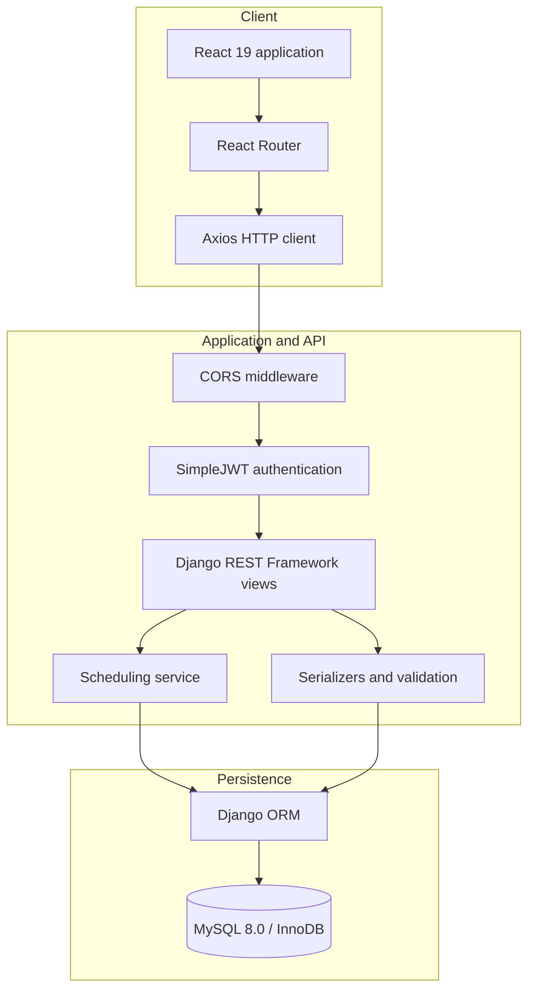

# AyurSutra

**Clinical management and multi-resource scheduling for Panchakarma healthcare facilities**

AyurSutra is a clinical management platform designed for Panchakarma hospitals and Ayurvedic wellness centres. It brings patient records, treatment plans, therapist workflows and appointment scheduling into one system.

A key part of the project is its scheduling engine. Unlike a conventional appointment calendar, a Panchakarma session may require a patient, a qualified therapist and a suitable treatment room to be available at the same time. The system checks these requirements before presenting available slots and validates them again when a session is booked.

The project combines a React frontend with a Django REST API and a MySQL database.

## The scheduling problem

Many appointment systems are built around a single provider and a fixed time slot. Panchakarma treatments have additional constraints:

- A session may require a specific treatment room or equipment.
- The patient and an appropriately qualified therapist must both be available.
- Treatment plans can run for several days and follow a defined sequence of clinical phases.
- A booking must not overlap with another session that uses the same room, therapist or patient.

AyurSutra addresses these constraints through multi-resource availability checks and booking-time validation. This reduces the risk of overlapping appointments and makes it easier for staff to coordinate treatment schedules.

## Architecture

The application is divided into three main layers.



- **Frontend:** A React 19 single-page application built with Vite. React Router handles navigation and role-based route guards. Axios manages API requests and token refresh.
- **Backend:** Django 6.1 and Django REST Framework 3.16 provide the REST API, application logic and request validation.
- **Database:** MySQL 8.0 with InnoDB stores application data and supports transactional operations and relational constraints.
- **Authentication:** SimpleJWT is used for access and refresh tokens. The frontend uses an Axios interceptor to refresh access tokens when required.

## Core functionality

### Multi-resource scheduling

The scheduling service is implemented in `backend/scheduling/services/scheduler.py`.

It evaluates candidate time slots against the availability of the room, therapist and patient. A slot is returned only when all three are available and it does not conflict with an existing session.

The scheduler uses a 30-minute time grid and checks the configured duration of each therapy when calculating the session end time.

Conceptually, a slot is available when:

\[
A = (W_r \cap W_t \cap W_p) \setminus C
\]

where \(W_r\), \(W_t\) and \(W_p\) represent room, therapist and patient availability, and \(C\) represents existing bookings.

### Booking validation and conflict handling

Availability can change between the time a slot is displayed and the time a user submits a booking. For that reason, the booking endpoint validates scheduling constraints again when the request is saved.

The overlap check uses the standard interval condition:

\[
(s_{\text{existing}} < e_{\text{requested}})
\land
(e_{\text{existing}} > s_{\text{requested}})
\]

The booking flow also checks prescribed session limits so that a patient cannot book more sessions than the treatment plan allows.

### Panchakarma treatment phases

Treatment plans are organised around the three phases of a Panchakarma programme:

1. **Purvakarma:** Preparatory procedures such as Deepana, Pachana, Snehana and Swedana.
2. **Pradhanakarma:** Primary procedures, including Vamana, Virechana, Basti, Nasya and Raktamokshana.
3. **Paschatkarma:** Post-treatment care, including Samsarjana Krama and Rasayana.

### Post-treatment diet guidance

The patient dashboard includes a four-stage Samsarjana Krama stepper for displaying the diet progression after detoxification:

1. **Peya:** Thin rice gruel or rice water.
2. **Vilepi:** Thick rice gruel.
3. **Yusha:** Lentil or pulse broth.
4. **Odana:** Soft-cooked rice.

### Therapist console

The therapist console is available at `/therapist/suite` and is designed for use on a tablet inside a treatment room. It includes:

- A high-contrast interface for use in dim treatment spaces.
- Large touch controls for recording procedure observations.
- A session countdown timer.
- A 0–10 patient discomfort rating.
- A control for recording session completion.

### Patient records and care certificate

The clinical record workflow captures patient details such as Prakriti, Vikriti, vital signs and Nadi Pariksha findings. It also supports clinical notes and a Pathya and Apathya matrix for recording dietary and lifestyle guidance.

A printable care certificate can be generated using print-specific CSS styles.

### Marma and Dosha visualizer

The application includes an interactive SVG-based anatomical visualizer covering the 107 Marma points. Users can select areas such as Shiro, Greeva, Hridaya, Kati, Janu and Pada to explore the related information presented by the application.

## User roles

Access is separated across four roles.

| Role | Main responsibilities | Portal routes |
|---|---|---|
| **Vaidya** | Patient assessment, clinical intake, diagnosis and treatment prescriptions | `/vaidya`, `/vaidya/patients`, `/vaidya/treatments`, `/vaidya/consultations` |
| **Patient** | Profile management, appointment booking, treatment progress and care certificate access | `/patient`, `/patient/profile`, `/patient/schedule`, `/patient/sessions` |
| **Therapist** | Daily session schedule, procedure observations, session timer and progress updates | `/therapist`, `/therapist/sessions`, `/therapist/suite`, `/therapist/progress` |
| **Administrator** | User management, treatment rooms, staff availability and facility schedules | `/admin`, `/admin/rooms`, `/admin/availability`, `/admin/schedules`, `/admin/users` |

## Data model

The backend is organised into four domain applications.

```text
accounts
  └── User
      └── Role: ADMIN, VAIDYA, THERAPIST, PATIENT

patients
  ├── PatientProfile
  ├── MedicalRecord
  ├── PatientAssessment
  └── Consultation

therapies
  ├── Therapy
  └── PatientTherapy

scheduling
  ├── Room
  ├── RoomAvailability
  ├── TherapistAvailability
  ├── PatientAvailability
  ├── TherapySession
  └── TherapyProgress
```

The models cover user roles, patient profiles and records, clinical assessments, consultations, therapy catalogues, prescriptions, resource availability, booked sessions and session progress.

## Technology stack

| Area | Technologies |
|---|---|
| Frontend | React 19, Vite 8.3, React Router DOM 7 |
| Styling and UI | Tailwind CSS, custom CSS, Lucide React, SVG |
| API client | Axios |
| Backend | Python 3.12, Django 6.1, Django REST Framework 3.16 |
| Authentication | `djangorestframework-simplejwt` |
| CORS | `django-cors-headers` |
| Database | MySQL 8.0 with InnoDB |
| Testing and quality | Django `APITestCase`, Python `unittest`, ESLint |

## Getting started

### Requirements

Make sure the following are installed:

- Python 3.11 or 3.12
- Node.js 18 or later
- MySQL Server 8.0 or later

### 1. Clone the repository

```bash
git clone https://github.com/AyushMalviyaDev/AyurSutra.git
cd AyurSutra
```

### 2. Set up the backend

Move into the backend directory:

```bash
cd backend
```

Create and activate a virtual environment.

**Windows PowerShell**

```powershell
python -m venv venv
.\venv\Scripts\Activate.ps1
```

**Linux or macOS**

```bash
python3 -m venv venv
source venv/bin/activate
```

Install the Python dependencies:

```bash
pip install -r requirements.txt
```

Create the MySQL database:

```sql
CREATE DATABASE ayursutra
CHARACTER SET utf8mb4
COLLATE utf8mb4_unicode_ci;
```

Configure the database connection in `config/settings.py` under `DATABASES`. Make sure the configured database name, username and password match your local MySQL setup.

Apply the migrations:

```bash
python manage.py migrate
```

To load the sample users, rooms, shifts and prescriptions, run:

```bash
python manage.py seed_demo
```

Start the Django development server:

```bash
python manage.py runserver
```

The API will be available at `http://127.0.0.1:8000/`.

### 3. Set up the frontend

Open another terminal, move to the frontend directory and install the dependencies:

```bash
cd frontend
npm install
```

Start the Vite development server:

```bash
npm run dev
```

The frontend will be available at `http://localhost:5173/`.

## Demo accounts

The `seed_demo` command creates the following development accounts. They all use the password `12345678`.

| Role | Username | Email |
|---|---|---|
| Patient | `ayush` | `ayush@example.com` |
| Vaidya | `vaidya1` | `vaidya@ayursutra.com` |
| Therapist | `therapist1` | `therapist@ayursutra.com` |
| Administrator | `admin1` | `admin@ayursutra.com` |

These credentials are intended for local development and demonstration only. Change or remove them before deploying the application.

## Running the tests

Run the backend test suite from the `backend` directory:

```bash
python manage.py test
```

The current test run reported 12 passing tests.

To check the frontend:

```bash
cd frontend
npm run lint
npm run build
```

The recorded frontend checks completed with no ESLint errors or warnings, and the production build completed successfully.

## API endpoints

The following table lists the main API routes.

| Method | Endpoint | Description | Access |
|---|---|---|---|
| `POST` | `/api/auth/register/` | Register a patient account | Public |
| `POST` | `/api/auth/login/` | Obtain a JWT token pair | Public |
| `POST` | `/api/auth/token/refresh/` | Refresh an access token | Valid refresh token |
| `GET` | `/api/auth/me/` | Retrieve the current user's profile | Authenticated |
| `GET` | `/api/scheduling/find-slots/` | Find available therapy slots | Authenticated |
| `POST` | `/api/scheduling/book-session/` | Validate and book a therapy session | Authenticated |
| `GET` | `/api/scheduling/sessions/` | Retrieve sessions according to the user's role | Authenticated, role-scoped |
| `POST` | `/api/scheduling/progress/` | Record session observations and discomfort rating | Therapists, Vaidyas, administrators |
| `GET`, `POST` | `/api/scheduling/rooms/` | Retrieve or manage therapy rooms | Authenticated for read; administrators for management |
| `GET`, `POST` | `/api/therapies/prescriptions/` | Retrieve or create treatment prescriptions | Vaidyas and administrators |

## Planned work

- Integrate with ABDM and FHIR standards.
- Add WhatsApp and SMS reminders for appointments and treatment preparation.
- Add WebRTC-based remote consultations.
- Integrate payment workflows.
- Support multiple facilities through a multi-tenant architecture.

## Project information

**Author:** Ayush Malviya  
**Department:** Computer Science and Engineering  
**Project:** B.Tech capstone project in healthcare informatics  
**GitHub:** [AyushMalviyaDev](https://github.com/AyushMalviyaDev)

## License

This project is licensed under the MIT License. See the [LICENSE](LICENSE) file for details.
